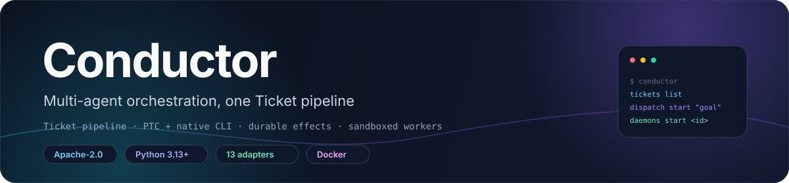

<div align="center">



# Conductor

**One local system where every coding agent and agent app works together: plan, implement, review, hand off and remember.**

[**简体中文**](README.zh-CN.md) · **English**

<a href="LICENSE"></a>
<a href="pyproject.toml"></a>
<a href="docs/ARCHITECTURE.md"></a>

</div>

Conductor is a self-hosted collaboration platform for the coding agents you already use. Its north star is one system in which every agent (the native CLIs that do the work) and every agent app (interactive sessions such as Claude Code, Codex or Cursor, and front ends such as DeepSeek Harness) can hand each other work, share memory and conversations, review each other and hand off, under one set of rules. Work is judged by how well the pieces interoperate, not by any one app.

In practice that means:
- **Dispatch.** You give Conductor a goal. A planner splits it into lines, native Worker CLIs (Kimi, GLM, Grok, Cursor, StepFun, DeepSeek, MiniMax and others) implement each line in its own git worktree, gates run the tests, a reviewer that did not write the code checks each line, and nothing merges until a person approves.
- **Tickets.** GitHub comments, chat messages, email, manual tasks and schedules become durable Tickets in Postgres. A Super-agent Router routes them to Workers and replies through an outbox.
- **Collaboration protocol.** Any registered agent app can list, claim, report, hand off and review work over MCP, CLI or HTTP with its own scoped token.
- **Memory.** Conductor keeps layered memory of its own and federates with memfw (Fleet Memory) for recall, shared conversation history and handoff packs.

It runs on your own machine, with your own keys and CLI logins.

**Status:** v1 shipped on 2026-11-07. Conductor now develops itself in dispatch rounds and waves. This README describes `main` after the 2026-11-14 wave (role registry, Super-agent assignment, operator verbs, the first PTC retirement lines, the DSH front end round and the terminal-native web pages) has merged. New behaviour ships off or in shadow mode; the owner decides each enforce flip (see [Status and roadmap](#status-and-roadmap)). Changes are in [`CHANGELOG.md`](CHANGELOG.md), test evidence and known limits in the internal document `RELEASE-READINESS` (not published).

## Contents

- [How it fits together](#how-it-fits-together)
- [Quick start](#quick-start)
- [Everyday use](#everyday-use)
- [Agent apps and the collaboration protocol](#agent-apps-and-the-collaboration-protocol)
- [Configuration and rollout modes](#configuration-and-rollout-modes)
- [Workers](#workers)
- [Memory and memfw](#memory-and-memfw)
- [Front ends](#front-ends)
- [Safety boundaries](#safety-boundaries)
- [Development](#development)
- [Docs map](#docs-map)
- [Status and roadmap](#status-and-roadmap)
- [Contributing](#contributing)
- [License and attribution](#license-and-attribution)

## How it fits together

```
                    agent apps (Claude Code, Codex, Cursor, DSH, ...)
                     │  MCP · conductor collab · /api/v1/collab   (N80, scoped app tokens)
                     ▼
  Sources ──► Tickets ──► Super-agent ──────────────────────► Workers (native CLIs)
  GitHub · Feishu ·        Router: routes only, never executes      own worktree per line/Ticket
  email · Slack ·          Watchdog: liveness checks                 report ─► Router ─► outbox
  manual · cron            Assignment (N73): model, effort, runtime
                     │
  goal ──► dispatch ──► planner ─► lines (DAG, parallel) ─► G2 tests ─► non-author review
                                     ─► G5 full suite ─► human approve ─► integrate branch ─► PR
                     │
  memory: User / Workspace / Session layers in Postgres ◄──► memfw (recall, history, handoff)
  front ends: web console · Super-agent TUI · DeepSeek Harness profile
```

**Super-agent.** The control plane follows the Super-agent design described by the DeepSeek Harness team (see [License and attribution](#license-and-attribution)): a Router that only routes, isolated Workers that report back through it, event-driven triggers, two-level admission, Inline & Spill context, Chain of Recall, attach and handback, and durable self-healing queues. The Router has a narrow tool set (route, recall, status, reply, watchdog, reassign) and no shell, file or web access. The Router (internal name `supervisor`) and the Watchdog can each run on **runtime P**, a small in-process Python turn loop, with `CONDUCTOR_SUPERAGENT_RUNTIME_SUPERVISOR=p` / `CONDUCTOR_SUPERAGENT_RUNTIME_WATCHDOG=p`; the code default is still `ptc`, and the local deploy runs the Watchdog on P. Details: [`docs/SUPER-AGENT.md`](docs/SUPER-AGENT.md).

**Roles (R6).** One role registry holds four roles: the Super-agent (Router), the planner, the reviewer and the worker. Each has candidates in preference order, a default and constraints. Every change needs a reason and is audited (`role_registry_audit`, migration 151). With nothing stored, the legacy settings apply exactly as before. The Router can hand off to another router candidate (for example on quota), carrying its Inline rows and Spill references.

**Dispatch.** `conductor dispatch start "<goal>"`:

1. **Plan.** The planner is the Claude Code CLI by default: it runs `claude -p` read-only (plan mode; Read, Grep and Glob only) inside the target checkout and returns a schema-checked JSON plan of at most 8 lines. Goals are capped at 4,000 characters. `CONDUCTOR_DISPATCH_PLANNER=llm` uses the model service instead, and a planner named in the role registry wins.
2. **Assign.** The Super-agent picks each line's model, effort and runtime in one structured call (N73); the dispatcher only checks feasibility (eligible, CLI on PATH, not breaker-open, headroom or paid credits, never the line's reviewer). An infeasible pick is asked once more, then falls back to the selector. In the default shadow mode the choice is recorded and the selector's pick runs. The selector ranks by per-category success, headroom and roster order.
3. **Implement.** Each line runs on its own branch, `feature/auto-dispatch-<id>/line-<line-id>`, in a registered worktree. Independent lines run in parallel, up to `CONDUCTOR_DISPATCH_MAX_PARALLEL_LINES` (default 4), never two lines with overlapping write scopes or beyond a provider's capacity. Workers get a context budget and can ask for a handoff when they run low (N29).
4. **Gate and review.** G2 runs the line's acceptance commands (lint counts only findings that are new against the base commit). A failure starts at most two fix rounds with the same author. A reviewer that is not the author then returns a JSON verdict `{"passed": …, "blockers": [...], "verdict": "…"}`; Codex is the primary reviewer, and lines on risk paths also get a secondary reviewer who sees facts only. Passed lines merge into `integrate/auto-dispatch-<id>`, and G5 runs the full suite.
5. **Approve and deliver.** The dispatch waits in `APPROVAL` until a person runs `approve` or `reject`. After approval, a live dispatch pushes the integration branch from its own worktree and opens a pull request, using a GitHub token from the user's vault; without a token the record says `needs_token`. `CONDUCTOR_DISPATCH_DELIVERY=off` keeps everything local. Per-attempt cost is recorded for `dispatch cost` (N30).

Stalls park with a named reason and a recovery step (liveness guardrails, N76); the table of park reasons is in [`docs/RUNBOOK.md`](docs/RUNBOOK.md). The default `CONDUCTOR_DISPATCH_ADAPTERS=dev` is a rehearsal: three fixed lines, no Workers, review always passes, nothing merges. The full state machine is in [`docs/ports/auto-dispatch.md`](docs/ports/auto-dispatch.md).

**Autonomy Tickets.** Each Source is polled; senders not on the allow-list are dropped before any model is called. A single-writer scheduler (Postgres advisory locks) dispatches Tickets, requeues Tickets whose run disappeared, and the Watchdog wakes or reassigns stuck work. Workers implement a Ticket in a Ticket worktree and report through the Router, which posts replies through a durable outbox. A GitHub Source on the operator's own token needs a `trigger_phrase` (2 to 40 characters such as `/conductor`, never an @-mention); `require_approval` holds every reply for a person, and email Sources hold replies by default.

## Quick start

**Requirements:**
- Python 3.13+ and uv
- Node.js with pnpm (the `packageManager` field pins pnpm 12)
- Docker, for PostgreSQL 18 and Redis
- the vendor CLIs you plan to use as Workers, installed and logged in on this machine

These steps were assembled from the Makefile and scripts; they have not been run end to end as one sequence.

```sh
git clone https://github.com/LeoLin990405/Conductor.git
cd Conductor
make install            # uv sync (dev, test and cli extras) + pnpm install in web/
make config             # interactive; writes .env and agent_config.yaml
make setup-db           # PostgreSQL + Redis in Docker on 127.0.0.1, then alembic upgrade head
(cd web && pnpm build)  # cond serves the built console from web/dist

ln -sfn "$PWD/scripts/cond" ~/.local/bin/cond   # ~/.local/bin must be on PATH
cond setup              # find the agent CLIs on this machine: installed, version, logged in
cond setup --write      # write ~/.conductor/agents.toml (mode 600, env names only, no secrets)
cond up                 # backend on 127.0.0.1:8000, console on 127.0.0.1:5170, fleet daemons
cond doctor
```

`cond agents login <cli>` hands the terminal to that CLI's own login. Without `~/.conductor/daemons.toml`, `cond up` starts only the backend and the console. On a fresh machine `cond doctor` reports failures until the policy files and the CodexBar snapshot exist (see [Configuration](#configuration-and-rollout-modes)).

**First dispatch:**

```sh
conductor workspace add ~/src/myrepo --name myrepo --default-worker kimi
uv run conductor dispatch start "Add a --json flag to the status command" --workspace myrepo
uv run conductor dispatch active
```

In `dev` mode this is a rehearsal. For a real run, start the backend with `CONDUCTOR_DISPATCH_ADAPTERS=live`, `CONDUCTOR_DISPATCH_LAUNCH_SCRIPT=scripts/dispatch_launch.sh` and `CONDUCTOR_DISPATCH_G5_COMMAND` (a dispatch needs G5 to reach approval). `CONDUCTOR_DISPATCH_REPO` is the checkout when no workspace is given.

`workspace add` records the path, the git remote (`origin` unless `--remote` is given), a sandbox policy and a default worker. `workspace-write` (the default) runs write Workers; `read-only` and unknown policies are refused rather than silently widening the sandbox. The server runs `git fetch --prune` in the checkout before a dispatch starts, and copies the checkout, policy and default worker onto the dispatch row, so later edits to the registry do not move a running dispatch.

Other ways to run the stack: `make dev` (backend with reload, binds `0.0.0.0:8000`), `make dev-web` (console on Vite's port 5173), and `make up` (Docker Compose; the images build, but `make up` has not been run end to end).

## Everyday use

**Dispatch** (`conductor dispatch …`). Only `start` starts a dispatch: any other unknown first word (`dispatch show <id>`, `dispatch list`) is refused with a "did you mean" hint, and so are one-word and verb-like goals. The old bare form `conductor dispatch "<goal>"` is gone.

| Command | What it does |
|---|---|
| `dispatch start "<goal>" [--workspace ID\|NAME] [--workers W,W]` | Plans and starts a dispatch |
| `dispatch active` (or `dispatch status` with no id) | Lists dispatches in progress |
| `dispatch status <id>` | Lines, gates, assignments, parallelism and a timeline |
| `dispatch assignments <id>` | The Super-agent's per-line choice and the selector's counterfactual (N73) |
| `dispatch cost [<id>] [--limit N]` | Per-attempt and per-model cost (N30) |
| `dispatch approve <id> [--note T]` | Passes the `APPROVAL` gate; delivery follows in live mode |
| `dispatch reject <id>` (aliases `cancel`, `abort`; `--force`) | Rejects or cancels; the branch is renamed `…-rejected` |
| `dispatch deliver <id>` | Retries the push and pull request of an approved, `COMPLETE` dispatch |
| `dispatch reassign <id> <line-id> <model>` | Moves a parked line to another Worker on the same branch. With N86 enforced, the human pick sticks and the line parks `pinned_worker_unusable` instead of falling back |
| `dispatch unblock <id> <line-id> [--note T]` | Moves an old parked line to a checkpoint so `reassign` works |
| `dispatch adjudicate <id> <line-id> in-scope\|out-of-scope [--note T]` | Rules on a reviewer's scope or security conflict (a security conflict needs `--note` to be ruled out of scope) |
| `dispatch recover <id> [<line-id>] [--split\|--human\|--rereview]` | Takes the next recovery step. `--rereview` (N87) is for a branch you fixed by hand: it re-runs G2 and review |
| `workspace add <path>` / `list` / `show <id\|name>` / `remove <id\|name>` | Registers the checkouts a dispatch may run against (`cond workspace …` forwards here) |

A refused request is an HTTP 409 whose text is the reason (`line_not_parked`, `drive_active`, …) and writes nothing. While a drive runs, `reassign`, `unblock`, `adjudicate` and `recover` are queued for its next step. If the server has no dispatch API, the CLI keeps a local record marked `fake: true`.

**Roles** (`conductor roles …`, R6): `roles show`, `roles set <router|planner|reviewer|worker> --reason TEXT [--candidates …] [--default …] [--constraint K=V] [--expected-revision N]`, and `roles audit [--role R] [--limit N]`. The same registry is at `GET/PUT /api/v1/roles`, the TUI `/roles` command and the web console (Settings, Roles). Hard rules cannot be configured off: the Router never executes, review is read-only, an author never reviews its own work, and a merge needs a human.

**The local deployment** (`cond …`, works with the backend down):

| Command | What it does |
|---|---|
| `cond up` / `cond down` (`start` / `stop`) | Start or stop the backend, the console and the fleet daemons. `stop` fences new Worker launches under the lifecycle lock |
| `cond restart [all\|daemons] [--drain]` | Rolling restart: backend, then web, then one daemon at a time |
| `cond drain [--reason T]` / `cond undrain` | Hold new dispatch launches and fix rounds (deploy prep), or release them |
| `cond status [--json]`, `cond logs [-n N] [component]` | Health and logs. `status` exits 1 if anything is down |
| `cond doctor [--json]` | Web port, daemon pids, policy-file permissions, orphan launches, the CodexBar snapshot and rules, Worker CLI health |
| `cond smoke [--timeout S] [--json]` | Sends one read-only Ticket to each configured daemon |
| `cond upgrade [--ref REF]` | Back up the database, check out the ref, sync, migrate, build the console, restart, check `/ready` |
| `cond setup [--write] [--force]`, `cond agents list\|set\|login` | Detect agent CLIs, write `agents.toml`, per-CLI settings, vendor login |
| `cond apps …`, `cond workspace …` | Forward to `conductor apps` and `conductor workspace` |
| `cond cli status` / `cond cli update [--only NAME] [--dry-run]` | Show or update the installed Worker CLIs |
| `cond backup`, `cond clean [--apply]`, `cond launchd install\|enable\|disable\|uninstall` | Database backup; stale worktrees, registrations and pid files; macOS LaunchAgents |
| `cond --version` | The tree `cond` runs from |
| `cond [--continue] [-p PROMPT] [--no-tui]` | No subcommand: `cond up`, then the Super-agent TUI |

Full reference: [`docs/COND.md`](docs/COND.md). Daily operations (start and stop, drain, deploy, rollback, backup and restore, logs, and what each park reason means) are in [`docs/RUNBOOK.md`](docs/RUNBOOK.md).

**Other `conductor` commands.** `tickets` (`list`, `show`, `create`, `reply`, `switch <id>` to move a stuck Ticket to another model while keeping its thread and worktree, and more), `sources`, `daemons list|register|start|stop|status`, `workers`, `usage`, `review run|status|verdict` (self-review refused), `merge --into BRANCH <line>` (rehearsed, host-local), `memory export|recall|propose|approve|reject`, `skills`, `mcp`, `skills-hub`, `instructions list|status|render|diff|apply|rollback|snapshots`, `browser` and `web` (an isolated agent browser), `impact`, `doctor`, `deploy` and `rollback`. The base URL is `--url`, then `CONDUCTOR_URL`, then `http://127.0.0.1:8000`. The default `HOST_MODE=oss` needs no token; otherwise `conductor auth set` stores a Bearer token with mode 0600. See [`docs/operations.md`](docs/operations.md).

## Agent apps and the collaboration protocol

The collaboration protocol (N80) lets any agent app take part as a peer. It is a thin layer: every verb lands on an existing object (Ticket, dispatch line, completion contract, Ticket worktree, review gate) and adds identity, leases, three transports and an audit trail. Each capability has the same JSON schema on MCP, CLI and HTTP (`/api/v1/collab`).

```sh
conductor apps register claude-code --scopes read,propose,claim,report --max-leases 1
conductor apps snippet claude-code        # prints the MCP hub entry; never applies it
conductor collab tasks --app claude-code  # act as that app from a shell
conductor-collab-mcp --app claude-code --read-only   # stdio MCP server; --http binds 127.0.0.1:8765
```

- `conductor apps register|list|scopes|rotate|revoke|audit|snippet` manages apps. Each app has its own token (held in the keychain, default `keychain:conductor-collab/<app>`), scopes and a lease limit (1 to 3).
- `conductor collab whoami|tasks|task|propose|claim|heartbeat|release|report|handoff|handoffs|accept|ask|inbox|review-request|reviews|review-submit` acts as an app. Exit codes: 0 ok, 1 refused by the server, 2 bad local input, 3 Conductor unreachable.
- `conductor-collab-mcp` serves the same tools over MCP to one app, loopback only. `--read-only` serves only the read tools plus `superagent_context`.
- Payloads are checked for secrets, rate-limited per app (fail closed) and wrapped in an envelope that marks untrusted fields.
- **Default off.** `CONDUCTOR_COLLAB_MODE` is `off` unless set (`off`, `shadow`, `docs`, `full`; blank or a typo means off). `docs` lets apps claim only docs, tests and Markdown tasks. Claimable dispatch lines (N80 L4) are not built yet.

Details: [`docs/ports/collab-protocol.md`](docs/ports/collab-protocol.md).

## Configuration and rollout modes

`.env` holds credentials and URLs; `config.yaml` and `agent_config.yaml` hold behaviour, and `APP_ENV` layers a sibling overlay over each YAML file.

**Rollout modes.** New behaviour ships `off` or `shadow` (record what it would do, change nothing) and moves to `enforce` only when the owner flips it. Unless noted, the values are `off`, `shadow` and `enforce`, and an unknown value falls back to shadow with a warning.

| Variable | Feature | Default |
|---|---|---|
| `CONDUCTOR_COLLAB_MODE` | Collaboration protocol (N80); values `off`, `shadow`, `docs`, `full` | **off** |
| `CONDUCTOR_DISPATCH_ASSIGN_MODE` | Super-agent assignment (N73); also `auto` | **shadow** when unset |
| `CONDUCTOR_DISPATCH_ASSIGN_SAMPLE` | Share of lines enforced in `enforce` mode | 1.0 |
| `CONDUCTOR_JUDGMENT_<USE>_MODE` / `_SAMPLE` | Fast judgment (N61): `WATCHDOG_PROGRESS`, `COMPLETION_EVIDENCE`, `ROUTER_PRESELECT`; `CONDUCTOR_JUDGMENT_MODE=off` is the kill switch | shadow, sample 0.1 |
| `CONDUCTOR_DISPATCH_SELECTOR_MODE` | Soft-weighted selection by success x headroom (R6) | shadow |
| `CONDUCTOR_DISPATCH_DEBUG_SWITCH_MODE` | Switch model at a repeated debug point (R6) | shadow |
| `CONDUCTOR_DISPATCH_HUMAN_PIN_MODE` | A human reassign sticks (N86) | shadow |
| `CONDUCTOR_DISPATCH_G2_PREEXISTING_MODE` | Park `preexisting_failure` when G2 fails the same way on the base (N27) | shadow |
| `CONDUCTOR_DISPATCH_REVIEW_REPRO_MODE` | Blockers must be reproducible (N51) | shadow |
| `CONDUCTOR_DISPATCH_REVIEW_INCONCLUSIVE_MODE` | Reviewer may answer INCONCLUSIVE (N59) | shadow |
| `CONDUCTOR_DISPATCH_VERIFIED_COMPLETION_MODE` | Verified completion evidence (N60) | shadow |
| `CONDUCTOR_DISPATCH_FRESH_BASE_MODE` | Start lines from a freshly fetched base, `CONDUCTOR_DISPATCH_BASE_REF` (N62) | shadow, `origin/main` |
| `CONDUCTOR_DISPATCH_LIVENESS_MODE` | Dispatch liveness guardrails (N76) | shadow |
| `CONDUCTOR_DISPATCH_G2_{REQUIRE_TESTS,WORKTREE_CHECK,SCOPE_CHECK}_MODE` | G2 checks (N46, N47, N52; record-only while N73 soft gates are on) | shadow |
| `CONDUCTOR_WORKER_EXEC_GUARD` | Scratch exec guard for isolated Workers (N19; blocks only with macOS Seatbelt) | shadow |
| `CONDUCTOR_DAEMON_GRANT_VERIFIER_MODE` | Device grant and result check (N44, N71) | shadow |
| `CONDUCTOR_LAUNCH_ADOPT_MODE` | Adopt orphan launches (N35) | shadow |

The N73 rollout does not start by itself. Only `CONDUCTOR_DISPATCH_ASSIGN_MODE=auto` starts it: shadow for 30 lines, a 50% sampled enforce until 40 lines ran on the Super-agent's choice, then full, with automatic rollback to shadow if that cohort's pass rate drops more than 10 points or its cost per line rises more than 50%. Paid credits count as headroom by default (`CONDUCTOR_DISPATCH_ALLOW_PAID_CREDITS=0` turns that off).

**Dispatch settings.**

| Variable | Meaning | Default |
|---|---|---|
| `CONDUCTOR_DISPATCH_ADAPTERS` | `dev` (rehearsal) or `live` | `dev` |
| `CONDUCTOR_DISPATCH_PLANNER` | `claude-code` or `llm` | `claude-code` |
| `CONDUCTOR_DISPATCH_REPO` | Checkout when no workspace is given | current directory |
| `CONDUCTOR_DISPATCH_G2_COMMAND`, `CONDUCTOR_DISPATCH_G5_COMMAND` | Fallback focused-test command, full-suite command | unset |
| `CONDUCTOR_DISPATCH_G2_LINT_BASELINE` | Count only new lint findings against the base | on |
| `CONDUCTOR_DISPATCH_MAX_PARALLEL_LINES` | Lines of one dispatch that may run at once (1 = serial) | 4 |
| `CONDUCTOR_DISPATCH_SERIAL_PROVIDERS` | Providers that run one Worker at a time (GLM's plan rate-limits concurrency) | `glm` |
| `CONDUCTOR_DISPATCH_DELIVERY` | `off` keeps an approved dispatch local | on |
| `CONDUCTOR_DISPATCH_COST_LEDGER`, `_COST_SELECTOR`, `_COST_WEIGHT` | Cost ledger, cost as a selector input (N30) | on, off, 0.15 |
| `CONDUCTOR_CONTEXT_SOFT_RATIO` | Context budget at which a Worker should hand off (N29) | 0.70 |
| `CONDUCTOR_ROLE_POLICY_FILE` | Role policy file (JSON or YAML); an unreadable file is an error, never a silent fallback | built-in roster |

**Role policy** (legacy, still read when the registry is empty): planner `claude` and primary reviewer `codex` (both reserved, never authors unless `allow_reserved_code`), developer pool `kimi`, `glm`, `grok`, `cursor`, `stepfun`, `deepseek`, `minimax`, work tail `doubao` (text-only), secondary reviewer `stepfun`. Code: `src/server/services/autonomy/roles.py`.

**Fleet file** `~/.conductor/daemons.toml` (`CONDUCTOR_DAEMONS_FILE`): optional `[backend]` and `[web]` sections; each `[[daemon]]` names a `provider`, an `id` and the env **names** it may receive. Each daemon needs a registered token and a workspace policy and refuses to start without them. Shared secrets live in `~/.conductor/secrets.env` (mode 600; symlinks refused). Dispatch Workers get the same per-provider allow-list, and no value is ever logged.

**CodexBar quota** ([`docs/CODEXBAR.md`](docs/CODEXBAR.md)): on macOS a launchd job writes `~/.conductor/usage/codexbar-snapshot.json` every 300 s. Routing, assignment and review read each provider as `available`, `low` or `exhausted`; a full plan window means exhausted. `cond doctor` fails `codexbar_rules` when the snapshot is missing, its version stamp differs from the validated version, or any provider shows schema drift. Without a snapshot every model counts as unlimited.

## Workers

Native CLI Workers run a vendor CLI in its own session (exec mode by default, ACP opt-in for some providers). Dispatch launches them through `scripts/dispatch_launch.sh`; Ticket Workers run on local daemons from the fleet file.

| Worker | CLI | Dispatch role |
|---|---|---|
| `kimi` | `kimi` | developer |
| `glm` (runtime `zcode`) | `zcode` | developer; one at a time (serial provider) |
| `grok` | `grok` | developer; no read-only mode, so never a reviewer |
| `cursor` | `cursor-agent` | developer; no read-only mode, so never a reviewer |
| `stepfun` | `step` | developer, secondary reviewer |
| `deepseek` (runtime `deepseek-dsh`) | `dsh` | developer |
| `minimax` | `mcode` | developer |
| `doubao` | `arkcli` | work tail, text-only (lines with a write scope are filtered out) |
| `opencode` | `opencode` | registered development Worker, not in the default dispatch pool |
| `codex` | `codex` | primary reviewer (reserved; the launcher refuses it as an author) |
| `claude` (runtime `claude-code`) | `claude` | planner (reserved; the launcher refuses it as an author) |
| `mimo` | `mimo` | runtime provider only, not a Worker |

The runtime registry (`src/server/services/native_runtime/registry.py`) has 13 runtime keys over 12 distinct CLIs: `zcode` and `zhipu` are the same GLM CLI. The MiniMax `mmx` text API is an adapter alias, not a Worker. Failures are classified into twelve classes (`rate_limited`, `overloaded`, `network`, `timeout`, `quota_exhausted`, `auth_failed`, `context_exhausted`, `turn_budget_exhausted`, `confirmation_required`, `tool_blocked`, `crash`, `unknown`) with per-provider rules; for example `tool_blocked` (a CLI's own safety gate refused a command) reassigns the line to another CLI. Adapters are in [`src/llms/native_cli`](src/llms/native_cli); see [`docs/NATIVE-CLI-AGENTS.md`](docs/NATIVE-CLI-AGENTS.md) and the internal document `WORKER-COVERAGE` (not published).

The inherited in-server PTC agent runtime (`src/ptc_agent`) is being retired (R9b). Workers are native CLIs only; what remains of PTC serves the Router's legacy runtime and the TUI until the remaining retirement lines land.

## Memory and memfw

- **Built-in memory.** Three layers (User, Workspace, Session) in Postgres ([`docs/MEMORY-LAYERS.md`](docs/MEMORY-LAYERS.md)). Workers receive a read-only memory block at launch. Native CLIs can only propose memories (the `remember` MCP tool); a person approves them with `conductor memory approve`. The search index is off by default (`REFACTOR_MEMORY_INDEX_ENABLED`). `conductor memory recall` searches it and `conductor memory propose` queues a proposal for approval; with the index off, recall returns no results and propose reports that it is unavailable.
- **memfw federation.** Read-only recall over the `memfw-http/2` contract, optionally staging approved memories back. Opt-in: it needs the index, a per-user binding under `memory_federation.user_bindings` in `config.yaml` (empty by default), the user's opt-in and a read token ([`docs/ports/memfw-v1-integration.md`](docs/ports/memfw-v1-integration.md)).
- **Notes MCP.** `agent_config.yaml` ships a read-only `memfw-notes` MCP server (`scripts/memfw_notes_mcp.py`) that answers once its `MEMFW_*` variables are set.
- **Shared conversations (M2).** memfw aggregates every local agent app's conversations into one local store, distils them into memory and skill candidates (always through proposal and approval), and builds handoff packs so work can continue in another CLI when one runs out of quota. Raw transcripts stay local. The DSH front end reads this through the memfw MCP. Plan: the internal planning note `m2-conversation-store` (not published).
- **Skills, MCP and instructions hubs.** One skill and MCP library rendered into every agent CLI with snapshots and rollback ([`docs/SKILLS-MCP-HUB.md`](docs/SKILLS-MCP-HUB.md)), and shared instruction files rendered per agent (`conductor instructions`).

## Front ends

- **Web console** ([`web`](web), React 19 + Vite, served by `cond` on port 5170). The terminal-native redesign is in: one token set and a Ctrl+K command palette shared with the TUI, and pages for the inbox, dispatch (including a start form), Tickets and Ticket detail, Agents, Agent fleet, Lines, Runs, Sources, Settings (with the Roles tab) and Legal. Design package: [`docs/design/terminal-native/README.md`](docs/design/terminal-native/README.md). An Electron shell is in [`desktop`](desktop).
- **Super-agent TUI** (`cond` with no subcommand, or `ptc-agent --super-agent`): the same palette, `/dispatch`, `/jobs`, `/attach`, `/agents`, `/roles`, `/review`, `/merge`, `/mcp` and more ([`docs/CLI-SUPERAGENT.md`](docs/CLI-SUPERAGENT.md)).
- **DeepSeek Harness (DSH).** DSH can be the conversation front end for the Super-agent: it keeps one session whose context Conductor owns (memory, conversations, Tickets and dispatch, compaction into handoff). Conductor dispatch stays the only scheduler. The thin adapter, lockdown, profile template and stubs are in a private prototype (not published); DSH reads Conductor through a read-only `conductor-collab-mcp` profile, a single-session guard refuses a second session, and DSH's own agent team, forge and session search are switched off. After every DSH upgrade, which the owner does by hand, the compat suite (C1 to C11) is rerun: a private runbook (not published).

## Safety boundaries

These are hard limits. The N73 soft gates (who takes a line, with which model) were opened; these were not.
- **No self-review.** A line's reviewer is never its author, and `review run` refuses self-review. The secondary reviewer sees facts, not the first reviewer's tally.
- **A person approves every merge.** Dispatch waits in `APPROVAL`; merge rehearses in a throwaway worktree, lands only the rehearsed commit, and is reachable only from loopback. Delivery pushes only an approved dispatch, from its own worktree.
- **The Router never executes.** It has no shell, files, web, subagents or MCP.
- **Workers are isolated.** Each runs in its own worktree, cannot push and does not read the real HOME's secrets. Local daemons need an isolation root and a per-workspace policy and refuse to start without them; without `daemon_policy.yaml` a daemon runs every operation it is sent, and without `daemon_trusted_keys.json` it does not verify lease signatures ([`docs/ports/worker-isolation.md`](docs/ports/worker-isolation.md)). Isolation is per workspace, not per tenant.
- **Loopback by default.** The backend, console and collab MCP bind 127.0.0.1 ([`docs/HARDENING.md`](docs/HARDENING.md)). Secrets files must be mode 600, and no secret value is logged.
- **Writes to the real environment need the owner.** Long-term memory, skills, MCP config and instruction files in the real HOME, and every enforce flip, go through proposal or approval.

## Development

- **One virtualenv per worktree**, made with `uv sync --frozen --extra test --extra cli` inside that worktree. Never share or symlink another checkout's `.venv`. Rules for agents working in this repo are in [`AGENTS.md`](AGENTS.md).
- **Tests:** `uv run pytest` (the default `addopts` deselects `integration`, `slow` and `regression`), `make test` (tests/unit/), `make test-web` (Vitest). CI ([`.github/workflows/test.yml`](.github/workflows/test.yml)) runs unit tests, integration tests against PostgreSQL and Redis, and the web and desktop checks.
- **Lint:** `uvx --offline ruff@0.15.14 check src tests` (needs a cached Ruff of the `uv.lock` version), or `make lint` (Ruff on `src/`, ESLint on `web/`).
- **Migrations:** `make migrate` (`alembic upgrade head`). The chain has a single head, `151_role_registry`. Downgrade limits are in [`MIGRATIONS.md`](MIGRATIONS.md).
- **Layout:** `src/server` (FastAPI, dispatch API, autonomy services), `src/tools/auto_dispatch` (planner, selector, gates, state machine, git), `src/llms` (model manifests, native CLI adapters), `src/collab` and `src/collab_mcp` (N80), `src/conductor_cli` (`conductor` and `cond`), `libs/ptc-cli` (TUI), `web`, `desktop`, `migrations`.

## Docs map

| Topic | Where |
|---|---|
| Daily operations, park reasons | [`docs/RUNBOOK.md`](docs/RUNBOOK.md), [`docs/COND.md`](docs/COND.md), [`docs/operations.md`](docs/operations.md) |
| Architecture and north star | [`docs/ARCHITECTURE.md`](docs/ARCHITECTURE.md) |
| Super-agent, roles, assignment | [`docs/SUPER-AGENT.md`](docs/SUPER-AGENT.md), [`docs/SUPER-AGENT-ALIGNMENT.md`](docs/SUPER-AGENT-ALIGNMENT.md) |
| Dispatch | [`docs/ports/auto-dispatch.md`](docs/ports/auto-dispatch.md) |
| Collaboration protocol | [`docs/ports/collab-protocol.md`](docs/ports/collab-protocol.md) |
| Workers | [`docs/NATIVE-CLI-AGENTS.md`](docs/NATIVE-CLI-AGENTS.md), [`docs/CODEXBAR.md`](docs/CODEXBAR.md) |
| Memory | [`docs/MEMORY-LAYERS.md`](docs/MEMORY-LAYERS.md), [`docs/ports/memfw-v1-integration.md`](docs/ports/memfw-v1-integration.md) |
| Front ends | [`docs/design/terminal-native/README.md`](docs/design/terminal-native/README.md), [`docs/CLI-SUPERAGENT.md`](docs/CLI-SUPERAGENT.md) |
| Security | [`docs/HARDENING.md`](docs/HARDENING.md), [`docs/ports/worker-isolation.md`](docs/ports/worker-isolation.md) |
| Plans and backlog | [`docs/ROADMAP.md`](docs/ROADMAP.md) |

## Status and roadmap

**Done** (merged, or merging with the 2026-11-14 wave):
- v1 (2026-11-07); self-iteration rounds since, with Conductor planning, writing and reviewing its own fixes.
- Dispatch: parallel lines (N31), liveness guardrails and the recover verb (N76), workspaces and delivery, the operator verbs `dispatch start` (N85), sticky human reassign (N86) and `recover --rereview` (N87), fresh base (N62), pre-existing failures (N27), reproducible blockers, inconclusive verdicts and verified completion (N51, N59, N60), the `tool_blocked` failure class, launch fencing (N35).
- Super-agent: runtime P for the Router and Watchdog (R8c), role registry, dynamic assignment, Router handoff and review isolation (R6), Super-agent assignment (N73 L1 to L5), fast judgment (N61), Worker context budget and handoff (N29), cost ledger (N30), device-policy result checks (N71), scratch exec guard (N19).
- Collaboration protocol N80 L1, L2, L3 and L5 (migration 150); DSH front end round (read-only profile, adapter hardening, compat suite); terminal-native web pages (F4, F5) and the i18n sweep (F6).
- PTC retirement: the first 12 behaviour-preserving R9b lines (shared code moved out of `ptc_agent`, unreachable modules deleted, hub imports cut).

**Pending:**
- **R9b remainder:** 17 lines, which wait for their prerequisites (both Super-agent roles on runtime P, the 0→1 test, and the front-end slices they collide with). They retire the in-server PTC Worker, sandboxes, subagents and the PTC graph, move the TUI into `src/conductor_cli`, and finally delete `src/ptc_agent` and `libs/ptc-cli`.
- **Z:** the 0→1 end-to-end test, run last.
- **Wave 2:** Conductor auto-handoff on `quota_exhausted` using memfw handoff packs (M2c), claimable dispatch lines for agent apps (N80 L4), and whatever this wave leaves open.
- **Owner decisions:** starting the N73 rollout (`CONDUCTOR_DISPATCH_ASSIGN_MODE=auto`); flipping the shadow features above to `enforce`; turning on `CONDUCTOR_COLLAB_MODE`; moving the Router to runtime P; deferred front-end slices (login, and some Plugins and Setup pages); dropping the `risk_preference` column (N65).

The roadmap is [`docs/ROADMAP.md`](docs/ROADMAP.md).

**Known limits:** Cloud Workers are opt-in, Codex-only and have not run with a real vendor credential ([`docs/CLOUD-WORKERS.md`](docs/CLOUD-WORKERS.md)). Vendor CLIs are not bundled. CodexBar quota data is macOS-only. The Docker Compose stack builds but has not been run end to end.

## Contributing

Read [`CONTRIBUTING.md`](CONTRIBUTING.md) before you open a pull request. Open an issue before you start a feature; bug fixes can go straight to a PR. Ask a maintainer before you add a third-party dependency or service. Write code and docstrings in English, and never commit `.env`, tokens or vault data. Every pull request needs passing tests, a single Alembic head and a maintainer review. [`MIGRATIONS.md`](MIGRATIONS.md) lists the migration notes and downgrade limits; revision 143 drops tables whose rows its downgrade cannot restore, so take a backup before upgrading across it.

## License and attribution

Conductor is licensed under the [Apache License 2.0](LICENSE). Copyright notices are in [`LICENSE`](LICENSE) and [`THIRD_PARTY_NOTICES.md`](THIRD_PARTY_NOTICES.md), and per-module provenance is in [`FORK-CN.md`](FORK-CN.md) and the matching [`docs/ports/`](docs/ports) files.

**Derived code.** Parts of the agent runtime and of the workspace and tooling infrastructure are derived from [LangAlpha](https://github.com/ginlix-ai/LangAlpha) (Apache-2.0). Its copyright notices are kept in [`LICENSE`](LICENSE) for as long as derived code remains; that runtime is being retired (R9b). Conductor is not operated or endorsed by the LangAlpha maintainers.

**Borrowed data.** The per-agent skill-directory table in `src/skills_hub/adapters.py` is adapted from [xingkongliang/skills-manager](https://github.com/xingkongliang/skills-manager) (MIT); the notice is in [`THIRD_PARTY_NOTICES.md`](THIRD_PARTY_NOTICES.md).

**Absorbed repositories.** Reference code from the archived `agos`, `mmteam-cc`, `xiaotie` and `model-farm-handoff` repositories lives under [`contrib/`](contrib), with the license each repository carried where it had one (`model-farm-handoff` had none; `contrib/dsh-agos` comes from the same `agos` absorption). It is not imported by the server or CLI. The provenance table is [`docs/ABSORBED.md`](docs/ABSORBED.md).

**Protocols.** `contrib/mmteam` implements wire-format compatibility with the [A2A protocol](https://a2a-protocol.org/latest/specification/) v0.3 and MCP; no third-party code is vendored (see `contrib/mmteam/NOTICE`).

**Other vendored or ported material.** `mfusepy` (ISC), the Source Han Sans font (SIL OFL 1.1), the vendored `langchain-zai` package and a port of the DeepSeek Harness image-token calculator. Their status and licenses are in [`THIRD_PARTY_NOTICES.md`](THIRD_PARTY_NOTICES.md); the DeepSeek port's upstream license is not confirmed and it is scheduled for deletion with R9b.

**Design references (ideas only, no code or text copied).**

- The control plane follows the Super-agent design that the DeepSeek Harness team describes in *Super-agent 设计探索：迈向更自主的 Agent 系统* ([source post](https://x.com/DeepSeekHarness/status/2116857257245987236)). Conductor is an independent implementation and is not affiliated with or endorsed by DeepSeek. The mapping is in [`docs/SUPER-AGENT-ALIGNMENT.md`](docs/SUPER-AGENT-ALIGNMENT.md).
- Typed judgments (N61) draw on the JEV-into-Harness decision flow described by Alibaba Cloud Native (*让 Agent 学会判断：从 JEV 接入到完整 Harness 决策流程*).
- Soft-weighted worker sampling (`src/tools/auto_dispatch/soft_select.py`, N5) follows the soft-label mechanism in Sakana AI's public description of [Fugu](https://sakana.ai/fugu/). The Fugu repository has no license, so none of its code or text is used.
