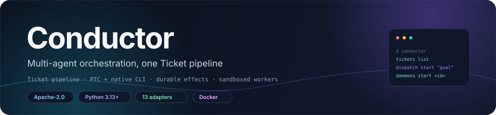

<div align="center">



# Conductor

**一个本地系统，让每个编程 Agent 和 Agent 应用协同工作：规划、实现、审查、交接、记忆。**

**简体中文** · [**English**](README.md)

<a href="LICENSE"></a>
<a href="pyproject.toml"></a>
<a href="docs/ARCHITECTURE.md"></a>

</div>

Conductor 是一个自托管的协作平台，服务于你已经在用的编程 Agent。它的北极星是一套统一的系统：每个 Agent（真正干活的原生 CLI）和每个 Agent 应用（Claude Code、Codex、Cursor 这类交互式会话，以及 DeepSeek Harness 这类前端）都能在同一套规则下互相派活、共享记忆与对话、互相审查、彼此交接。衡量工作的标准是各部分之间的互通程度，而不是某一个应用本身。

落到实处，就是这几件事：
- **dispatch。** 你给 Conductor 一个目标。Planner 把它拆成若干条线（line），原生 Worker CLI（Kimi、GLM、Grok、Cursor、StepFun、DeepSeek、MiniMax 等）在各自的 git worktree 里实现每条线，关卡负责跑测试，一个没有写这段代码的审查者检查每条线；没有人批准，任何代码都不会合并。
- **Ticket。** GitHub 评论、聊天消息、邮件、手动任务和定时任务都会变成 Postgres 里的持久 Ticket。Super-agent Router 把它们路由给 Worker，并经 outbox 发出回复。
- **协作协议。** 任何已登记的 Agent 应用都可以用自己限定范围的 Token，通过 MCP、CLI 或 HTTP 列出、认领、汇报、交接和审查工作。
- **记忆。** Conductor 自己维护分层记忆，并与 memfw（Fleet Memory）联邦，用于召回、共享对话历史和交接包。

它跑在你自己的机器上，用你自己的 key 和 CLI 登录。

**状态：** v1 已于 2026-11-07 发布。Conductor 现在以 dispatch 轮次和波次（wave）的方式开发它自己。本 README 描述的是 2026-11-14 这一波（角色注册表、Super-agent 分配、运维动词、首批 PTC 退役线、DSH 前端轮次以及终端原生的 web 页面）合并之后的 `main`。新行为默认以关闭或 shadow 模式发布；每一次切到 enforce 都由 owner 决定（见[状态与路线图](#状态与路线图)）。更新内容见 [`CHANGELOG.md`](CHANGELOG.md)；测试证据与已知限制见 内部文档 `RELEASE-READINESS`（未公开）。

## 目录

- [整体结构](#整体结构)
- [快速开始](#快速开始)
- [日常使用](#日常使用)
- [Agent 应用与协作协议](#agent-应用与协作协议)
- [配置与发布模式](#配置与发布模式)
- [Worker](#worker)
- [记忆与 memfw](#记忆与-memfw)
- [前端](#前端)
- [安全边界](#安全边界)
- [开发](#开发)
- [文档地图](#文档地图)
- [状态与路线图](#状态与路线图)
- [参与贡献](#参与贡献)
- [许可证与署名](#许可证与署名)

## 整体结构

```
                    Agent 应用（Claude Code、Codex、Cursor、DSH……）
                     │  MCP · conductor collab · /api/v1/collab   （N80，按应用限定范围的 token）
                     ▼
  Source ───► Ticket ───► Super-agent ──────────────────────► Worker（原生 CLI）
  GitHub · 飞书 ·          Router：只路由、从不执行                  每条线 / 每个 Ticket 一个 worktree
  邮件 · Slack ·           Watchdog：存活检查                       汇报 ─► Router ─► outbox
  手动 · cron              分配（N73）：模型、effort、运行时
                     │
  目标 ──► dispatch ──► Planner ─► 若干条线（DAG，并行）─► G2 测试 ─► 非作者审查
                                     ─► G5 全量测试 ─► 人工批准 ─► 集成分支 ─► PR
                     │
  记忆：Postgres 中的 User / Workspace / Session 三层 ◄──► memfw（召回、历史、交接）
  前端：web 控制台 · Super-agent TUI · DeepSeek Harness profile
```

**Super-agent。** 控制面沿用 DeepSeek Harness 团队描述的 Super-agent 设计（见[许可证与署名](#许可证与署名)）：只负责路由的 Router、通过 Router 汇报的隔离 Worker、事件驱动的 Trigger、两级准入、Inline & Spill 上下文、Chain of Recall、attach 与 handback，以及持久、可自愈的队列。Router 只有一组很窄的工具（路由、回忆、状态、回复、watchdog、改派），没有 shell、文件或网络访问。Router（内部名 `supervisor`）和 Watchdog 各自都可以跑在 **runtime P** 上，这是一个很小的进程内 Python 轮次循环，分别用 `CONDUCTOR_SUPERAGENT_RUNTIME_SUPERVISOR=p` / `CONDUCTOR_SUPERAGENT_RUNTIME_WATCHDOG=p` 开启；代码默认值仍是 `ptc`，本地部署让 Watchdog 跑在 P 上。细节见 [`docs/SUPER-AGENT.md`](docs/SUPER-AGENT.md)。

**角色（R6）。** 一个角色注册表管理四个角色：Super-agent（Router）、Planner、审查者和 Worker。每个角色都有按偏好排序的候选、一个默认值和若干约束。每次修改都要写明理由并留下审计记录（`role_registry_audit`，迁移 151）。注册表为空时，沿用旧设置，行为与以前完全一致。Router 可以交接给另一个 Router 候选（例如额度用尽时），同时带上它的 Inline 行和 Spill 引用。

**dispatch。** `conductor dispatch start "<goal>"`：

1. **规划。** Planner 默认是 Claude Code CLI：它在目标检出目录里以只读方式运行 `claude -p`（plan 模式，只开放 Read、Grep、Glob），返回一份经过 schema 校验、最多 8 条线的 JSON 计划。目标最长 4,000 个字符。设置 `CONDUCTOR_DISPATCH_PLANNER=llm` 改为调用模型服务；角色注册表里指定的 Planner 优先。
2. **分配。** Super-agent 用一次结构化调用为每条线选定模型、effort 和运行时（N73）；dispatcher 只检查可行性（符合资格、CLI 在 PATH 上、熔断器未打开、有额度余量或付费 credits、绝不是这条线的审查者）。不可行的选择会再问一次，仍不行就回退到选择器。在默认的 shadow 模式下，只记录 Super-agent 的选择，实际运行的是选择器的结果。选择器按分类成功率、额度余量和名单顺序排序。
3. **实现。** 每条线在已登记的 worktree 里、在自己的分支 `feature/auto-dispatch-<id>/line-<line-id>` 上运行。彼此独立的线并行执行，上限是 `CONDUCTOR_DISPATCH_MAX_PARALLEL_LINES`（默认 4）；写入范围重叠的两条线不会同时跑，也不会超出某个厂商的容量。Worker 拿到一份上下文预算，快用完时可以申请交接（N29）。
4. **关卡与审查。** G2 运行这条线的验收命令（lint 只统计相对基准提交新增的问题）。失败时，同一个作者最多做两轮修复。随后由一个不是作者的审查者给出 JSON 结论 `{"passed": …, "blockers": [...], "verdict": "…"}`；Codex 是主审查者，改动涉及风险路径的线还要经过一位只看事实的次审查者。通过的线合并进 `integrate/auto-dispatch-<id>`，然后由 G5 跑全量测试。
5. **批准与交付。** dispatch 停在 `APPROVAL`，直到有人执行 `approve` 或 `reject`。批准后，live 模式的 dispatch 会从它自己的 worktree 推送集成分支并开一个 pull request，使用的是用户 vault 里的 GitHub token；没有 token 时，记录里会写 `needs_token`。设置 `CONDUCTOR_DISPATCH_DELIVERY=off` 则一切留在本地。每次尝试的成本都会记录下来，供 `dispatch cost` 查看（N30）。

卡住的工作会带着具名原因和恢复步骤停放（park）（存活护栏，N76）；停放原因一览表见 [`docs/RUNBOOK.md`](docs/RUNBOOK.md)。默认的 `CONDUCTOR_DISPATCH_ADAPTERS=dev` 是一次演练：三条固定的线，不启动 Worker，审查总是通过，也不合并。完整的状态机见 [`docs/ports/auto-dispatch.md`](docs/ports/auto-dispatch.md)。

**自治 Ticket。** 每个 Source 都会被轮询；不在允许名单上的发送者，在调用任何模型之前就会被丢弃。一个单写者调度器（Postgres advisory lock）负责派发 Ticket，把运行已消失的 Ticket 重新排队，Watchdog 则唤醒或改派卡住的工作。Worker 在 Ticket worktree 里实现 Ticket，并通过 Router 汇报，Router 再经持久的 outbox 发出回复。用运营者自己 token 运行的 GitHub Source 必须设置 `trigger_phrase`（2 到 40 个字符，例如 `/conductor`，不能是 @ 提及）；`require_approval` 让每条回复都先交给人确认，邮件 Source 默认就会先交给人确认。

## 快速开始

**环境要求：**
- Python 3.13+ 和 uv
- Node.js 与 pnpm（`packageManager` 字段锁定 pnpm 12）
- Docker，用来运行 PostgreSQL 18 和 Redis
- 你打算用作 Worker 的厂商 CLI，在本机装好并登录

以下步骤是根据 Makefile 和脚本整理出来的，还没有作为一个完整流程从头到尾跑过。

```sh
git clone https://github.com/LeoLin990405/Conductor.git
cd Conductor
make install            # uv sync（dev、test、cli extra）+ 在 web/ 里 pnpm install
make config             # 交互式；写入 .env 和 agent_config.yaml
make setup-db           # 在 Docker 中启动 PostgreSQL + Redis（127.0.0.1），然后 alembic upgrade head
(cd web && pnpm build)  # cond 提供的是 web/dist 里构建好的控制台

ln -sfn "$PWD/scripts/cond" ~/.local/bin/cond   # ~/.local/bin 需要在 PATH 里
cond setup              # 查找本机的 Agent CLI：是否安装、版本、是否已登录
cond setup --write      # 写入 ~/.conductor/agents.toml（权限 600，只含 env 名称，不含密钥）
cond up                 # 后端 127.0.0.1:8000，控制台 127.0.0.1:5170，外加 fleet 里的 daemon
cond doctor
```

`cond agents login <cli>` 把终端交给该 CLI 自己的登录流程。没有 `~/.conductor/daemons.toml` 时，`cond up` 只启动后端和控制台。在一台全新的机器上，策略文件和 CodexBar 快照都就位之前，`cond doctor` 会报告失败（见[配置](#配置与发布模式)）。

**第一次派发：**

```sh
conductor workspace add ~/src/myrepo --name myrepo --default-worker kimi
uv run conductor dispatch start "给 status 命令加一个 --json 参数" --workspace myrepo
uv run conductor dispatch active
```

在 `dev` 模式下，这只是一次演练。要真实运行，启动后端时设置 `CONDUCTOR_DISPATCH_ADAPTERS=live`、`CONDUCTOR_DISPATCH_LAUNCH_SCRIPT=scripts/dispatch_launch.sh` 和 `CONDUCTOR_DISPATCH_G5_COMMAND`（dispatch 要走到批准这一步需要 G5）。没有指定 workspace 时，检出目录取 `CONDUCTOR_DISPATCH_REPO`。

`workspace add` 记录路径、git remote（默认是 `origin`，可用 `--remote` 指定）、sandbox policy 和默认 worker。`workspace-write`（默认）允许运行写入型 Worker；`read-only` 和未知的 policy 都会被拒绝，而不是悄悄放宽 sandbox。dispatch 启动前，服务端会在该检出目录里运行 `git fetch --prune`，并把检出目录、policy 和默认 worker 复制到 dispatch 行上，因此之后修改登记表不会影响正在运行的 dispatch。

运行整套服务的其他方式：`make dev`（以 reload 模式运行后端，绑定 `0.0.0.0:8000`）、`make dev-web`（在 Vite 的端口 5173 上运行控制台）和 `make up`（Docker Compose；镜像能构建，但 `make up` 还没有完整跑过）。

## 日常使用

**dispatch**（`conductor dispatch …`）。只有 `start` 会启动 dispatch：其他任何未知的首词（`dispatch show <id>`、`dispatch list`）都会被拒绝，并给出"did you mean"提示；只有一个词或像动词的目标同样会被拒绝。旧的裸写法 `conductor dispatch "<goal>"` 已经去掉。

| 命令 | 作用 |
|---|---|
| `dispatch start "<goal>" [--workspace ID\|NAME] [--workers W,W]` | 规划并启动一次 dispatch |
| `dispatch active`（或不带 id 的 `dispatch status`） | 列出进行中的 dispatch |
| `dispatch status <id>` | 各条线、关卡、分配、并行情况和时间线 |
| `dispatch assignments <id>` | Super-agent 对每条线的选择，以及选择器的反事实结果（N73） |
| `dispatch cost [<id>] [--limit N]` | 按尝试和按模型统计的成本（N30） |
| `dispatch approve <id> [--note T]` | 通过 `APPROVAL` 关卡；live 模式下随后交付 |
| `dispatch reject <id>`（别名 `cancel`、`abort`；`--force`） | 拒绝或取消；分支改名为 `…-rejected` |
| `dispatch deliver <id>` | 对已批准、处于 `COMPLETE` 的 dispatch 重试推送和 pull request |
| `dispatch reassign <id> <line-id> <model>` | 把一条停放的线改派给另一个 Worker，分支不变。N86 进入 enforce 后，人的选择会被固定，Worker 不可用时这条线停放为 `pinned_worker_unusable`，而不是回退 |
| `dispatch unblock <id> <line-id> [--note T]` | 把一条较早停放的线移到检查点，让 `reassign` 可用 |
| `dispatch adjudicate <id> <line-id> in-scope\|out-of-scope [--note T]` | 裁决审查者提出的范围或安全冲突（要把安全冲突判为超出范围，必须带 `--note`） |
| `dispatch recover <id> [<line-id>] [--split\|--human\|--rereview]` | 执行下一个恢复步骤。`--rereview`（N87）用于你手动修好的分支：重新跑 G2 和审查 |
| `workspace add <path>` / `list` / `show <id\|name>` / `remove <id\|name>` | 登记 dispatch 可以使用的检出目录（`cond workspace …` 会转发到这里） |

被拒绝的请求返回 HTTP 409，正文就是原因（`line_not_parked`、`drive_active` 等），且不写入任何东西。驱动循环运行期间，`reassign`、`unblock`、`adjudicate` 和 `recover` 会排队等它的下一步。如果服务器没有 dispatch API，CLI 会在本地保存一条标记为 `fake: true` 的记录。

**角色**（`conductor roles …`，R6）：`roles show`、`roles set <router|planner|reviewer|worker> --reason TEXT [--candidates …] [--default …] [--constraint K=V] [--expected-revision N]` 和 `roles audit [--role R] [--limit N]`。同一个注册表也可以通过 `GET/PUT /api/v1/roles`、TUI 的 `/roles` 命令和 web 控制台（Settings → Roles）访问。硬性规则无法通过配置关掉：Router 从不执行，审查是只读的，作者从不审查自己的工作，合并需要人来做。

**本地部署**（`cond …`，后端没起来时也能用）：

| 命令 | 作用 |
|---|---|
| `cond up` / `cond down`（`start` / `stop`） | 启动或停止后端、控制台和 fleet 里的 daemon。`stop` 会在生命周期锁下拦住新的 Worker 启动 |
| `cond restart [all\|daemons] [--drain]` | 滚动重启：先后端，再 web，再逐个 daemon |
| `cond drain [--reason T]` / `cond undrain` | 暂停新的 dispatch 启动和修复轮（为部署做准备），或解除暂停 |
| `cond status [--json]`、`cond logs [-n N] [component]` | 健康状态与日志。只要有组件没起来，`status` 就以 1 退出 |
| `cond doctor [--json]` | 检查 web 端口、daemon pid、策略文件权限、孤儿启动、CodexBar 快照与规则，以及 Worker CLI 的健康状态 |
| `cond smoke [--timeout S] [--json]` | 给每个已配置的 daemon 发一个只读 Ticket |
| `cond upgrade [--ref REF]` | 备份数据库、检出指定 ref、同步依赖、迁移、构建控制台、重启并检查 `/ready` |
| `cond setup [--write] [--force]`、`cond agents list\|set\|login` | 检测 Agent CLI、写入 `agents.toml`、按 CLI 设置、厂商登录 |
| `cond apps …`、`cond workspace …` | 转发到 `conductor apps` 和 `conductor workspace` |
| `cond cli status` / `cond cli update [--only NAME] [--dry-run]` | 查看或更新已安装的 Worker CLI |
| `cond backup`、`cond clean [--apply]`、`cond launchd install\|enable\|disable\|uninstall` | 数据库备份；清理过期的 worktree、登记记录和 pid 文件；macOS LaunchAgent |
| `cond --version` | `cond` 当前运行所在的代码树 |
| `cond [--continue] [-p PROMPT] [--no-tui]` | 不带子命令：先 `cond up`，再打开 Super-agent TUI |

完整说明见 [`docs/COND.md`](docs/COND.md)。日常运维（启停、drain、部署、回滚、备份与恢复、日志，以及每种停放原因的含义）见 [`docs/RUNBOOK.md`](docs/RUNBOOK.md)。

**其他 `conductor` 命令。** `tickets`（`list`、`show`、`create`、`reply`、`switch <id>`（把卡住的 Ticket 换给另一个模型，保留它的线程和 worktree）等）、`sources`、`daemons list|register|start|stop|status`、`workers`、`usage`、`review run|status|verdict`（拒绝自我审查）、`merge --into BRANCH <line>`（先演练，仅限本机）、`memory export|recall|propose|approve|reject`、`skills`、`mcp`、`skills-hub`、`instructions list|status|render|diff|apply|rollback|snapshots`、`browser` 和 `web`（隔离的 Agent 浏览器）、`impact`、`doctor`、`deploy` 和 `rollback`。基础 URL 依次取 `--url`、`CONDUCTOR_URL`、`http://127.0.0.1:8000`。默认的 `HOST_MODE=oss` 不需要 token；否则用 `conductor auth set` 保存 Bearer token（权限 0600）。见 [`docs/operations.md`](docs/operations.md)。

## Agent 应用与协作协议

协作协议（N80）让任何 Agent 应用都能以对等身份参与进来。它只是很薄的一层：每个动词都落在已有的对象上（Ticket、dispatch 线、完成契约、Ticket worktree、审查关卡），在此之上补充身份、租约、三种传输方式和审计记录。每项能力在 MCP、CLI 和 HTTP（`/api/v1/collab`）上都使用同一份 JSON schema。

```sh
conductor apps register claude-code --scopes read,propose,claim,report --max-leases 1
conductor apps snippet claude-code        # 打印 MCP 中心条目；从不自动应用
conductor collab tasks --app claude-code  # 在 shell 里以该应用的身份操作
conductor-collab-mcp --app claude-code --read-only   # stdio MCP 服务；--http 绑定 127.0.0.1:8765
```

- `conductor apps register|list|scopes|rotate|revoke|audit|snippet` 管理应用。每个应用都有自己的 token（存放在 keychain 中，默认 `keychain:conductor-collab/<app>`）、scope 和租约上限（1 到 3）。
- `conductor collab whoami|tasks|task|propose|claim|heartbeat|release|report|handoff|handoffs|accept|ask|inbox|review-request|reviews|review-submit` 以某个应用的身份操作。退出码：0 成功，1 被服务端拒绝，2 本地输入有误，3 连不上 Conductor。
- `conductor-collab-mcp` 通过 MCP 为单个应用提供同一套工具，只监听回环地址。`--read-only` 只提供读工具和 `superagent_context`。
- 载荷会检查是否含有密钥，按应用限流（失败即关闭），并包在一个标出不可信字段的信封里。
- **默认关闭。** 不设置时 `CONDUCTOR_COLLAB_MODE` 为 `off`（可选 `off`、`shadow`、`docs`、`full`；留空或拼错都按 off 处理）。`docs` 只允许应用认领文档、测试和 Markdown 任务。可认领的 dispatch 线（N80 L4）还没有实现。

细节见 [`docs/ports/collab-protocol.md`](docs/ports/collab-protocol.md)。

## 配置与发布模式

`.env` 放凭据和 URL；`config.yaml` 和 `agent_config.yaml` 放行为配置，`APP_ENV` 会在每个 YAML 文件上叠加同目录下的覆盖文件。

**发布模式。** 新行为以 `off` 或 `shadow`（记录它会怎么做，但不改变任何东西）发布，只有 owner 切换后才进入 `enforce`。除非另有说明，取值都是 `off`、`shadow` 和 `enforce`，未知值会回退到 shadow 并给出警告。

| 变量 | 功能 | 默认值 |
|---|---|---|
| `CONDUCTOR_COLLAB_MODE` | 协作协议（N80）；取值 `off`、`shadow`、`docs`、`full` | **off** |
| `CONDUCTOR_DISPATCH_ASSIGN_MODE` | Super-agent 分配（N73）；另有 `auto` | 不设置时为 **shadow** |
| `CONDUCTOR_DISPATCH_ASSIGN_SAMPLE` | `enforce` 模式下实际执行的线所占比例 | 1.0 |
| `CONDUCTOR_JUDGMENT_<USE>_MODE` / `_SAMPLE` | 快速判断（N61）：`WATCHDOG_PROGRESS`、`COMPLETION_EVIDENCE`、`ROUTER_PRESELECT`；`CONDUCTOR_JUDGMENT_MODE=off` 是总开关 | shadow，采样 0.1 |
| `CONDUCTOR_DISPATCH_SELECTOR_MODE` | 按成功率 × 额度余量的软加权选择（R6） | shadow |
| `CONDUCTOR_DISPATCH_DEBUG_SWITCH_MODE` | 在重复出现的调试点切换模型（R6） | shadow |
| `CONDUCTOR_DISPATCH_HUMAN_PIN_MODE` | 人工改派的选择固定不变（N86） | shadow |
| `CONDUCTOR_DISPATCH_G2_PREEXISTING_MODE` | G2 在基准上以同样方式失败时停放为 `preexisting_failure`（N27） | shadow |
| `CONDUCTOR_DISPATCH_REVIEW_REPRO_MODE` | blocker 必须可复现（N51） | shadow |
| `CONDUCTOR_DISPATCH_REVIEW_INCONCLUSIVE_MODE` | 审查者可以给出 INCONCLUSIVE（N59） | shadow |
| `CONDUCTOR_DISPATCH_VERIFIED_COMPLETION_MODE` | 经过验证的完成证据（N60） | shadow |
| `CONDUCTOR_DISPATCH_FRESH_BASE_MODE` | 从刚 fetch 的基准 `CONDUCTOR_DISPATCH_BASE_REF` 起线（N62） | shadow，`origin/main` |
| `CONDUCTOR_DISPATCH_LIVENESS_MODE` | dispatch 存活护栏（N76） | shadow |
| `CONDUCTOR_DISPATCH_G2_{REQUIRE_TESTS,WORKTREE_CHECK,SCOPE_CHECK}_MODE` | G2 检查（N46、N47、N52；N73 软门开启期间只记录） | shadow |
| `CONDUCTOR_WORKER_EXEC_GUARD` | 隔离 Worker 的临时目录 exec 防护（N19；只有在 macOS Seatbelt 下才会拦截） | shadow |
| `CONDUCTOR_DAEMON_GRANT_VERIFIER_MODE` | 设备授权与结果校验（N44、N71） | shadow |
| `CONDUCTOR_LAUNCH_ADOPT_MODE` | 接管孤儿启动（N35） | shadow |

N73 的发布不会自己开始。只有 `CONDUCTOR_DISPATCH_ASSIGN_MODE=auto` 才会启动它：先 shadow 30 条线，再以 50% 采样 enforce，直到 40 条线按 Super-agent 的选择跑完，然后全面 enforce；如果这批线的通过率下降超过 10 个百分点，或每条线的成本上升超过 50%，会自动回滚到 shadow。付费 credits 默认算作额度余量（`CONDUCTOR_DISPATCH_ALLOW_PAID_CREDITS=0` 可关闭）。

**dispatch 设置。**

| 变量 | 含义 | 默认值 |
|---|---|---|
| `CONDUCTOR_DISPATCH_ADAPTERS` | `dev`（演练）或 `live` | `dev` |
| `CONDUCTOR_DISPATCH_PLANNER` | `claude-code` 或 `llm` | `claude-code` |
| `CONDUCTOR_DISPATCH_REPO` | 没有指定 workspace 时使用的检出目录 | 当前目录 |
| `CONDUCTOR_DISPATCH_G2_COMMAND`、`CONDUCTOR_DISPATCH_G5_COMMAND` | 兜底的聚焦测试命令、全量测试命令 | 不设置 |
| `CONDUCTOR_DISPATCH_G2_LINT_BASELINE` | 只统计相对基准新增的 lint 问题 | on |
| `CONDUCTOR_DISPATCH_MAX_PARALLEL_LINES` | 同一个 dispatch 可同时运行的线数（1 = 串行） | 4 |
| `CONDUCTOR_DISPATCH_SERIAL_PROVIDERS` | 同一时间只跑一个 Worker 的厂商（GLM 的套餐会对并发限流） | `glm` |
| `CONDUCTOR_DISPATCH_DELIVERY` | `off` 时已批准的 dispatch 留在本地 | on |
| `CONDUCTOR_DISPATCH_COST_LEDGER`、`_COST_SELECTOR`、`_COST_WEIGHT` | 成本台账，以及把成本作为选择器输入（N30） | on、off、0.15 |
| `CONDUCTOR_CONTEXT_SOFT_RATIO` | Worker 应当交接时的上下文预算比例（N29） | 0.70 |
| `CONDUCTOR_ROLE_POLICY_FILE` | 角色策略文件（JSON 或 YAML）；文件读不了就报错，绝不悄悄回退 | 内置名单 |

**角色策略**（旧机制，注册表为空时仍会读取）：Planner `claude` 和主审查者 `codex`（两者都是保留角色，除非设置 `allow_reserved_code`，否则从不当作者），开发者池 `kimi`、`glm`、`grok`、`cursor`、`stepfun`、`deepseek`、`minimax`，补位（work tail）`doubao`（仅文本），次审查者 `stepfun`。代码：`src/server/services/autonomy/roles.py`。

**Fleet 文件** `~/.conductor/daemons.toml`（`CONDUCTOR_DAEMONS_FILE`）：可选的 `[backend]` 和 `[web]` 段；每个 `[[daemon]]` 条目写明 `provider`、`id`，以及它可以收到的环境变量**名称**。每个 daemon 都需要一个已登记的 token 和一份工作区策略，缺了就拒绝启动。共用的密钥放在 `~/.conductor/secrets.env`（权限 600；符号链接会被拒绝）。dispatch Worker 拿到的是同一份按厂商划分的允许名单，任何值都不会写进日志。

**CodexBar 额度**（[`docs/CODEXBAR.md`](docs/CODEXBAR.md)）：在 macOS 上，一个 launchd 任务每 300 秒写出一次 `~/.conductor/usage/codexbar-snapshot.json`。路由、分配和审查把每个厂商读成 `available`、`low` 或 `exhausted`；套餐窗口满了即算 exhausted。快照缺失、版本戳与已验证版本不同，或任一厂商出现 schema 漂移时，`cond doctor` 的 `codexbar_rules` 检查失败。没有快照时，每个模型都按不限额处理。

## Worker

原生 CLI Worker 在厂商 CLI 自己的会话里运行（默认 exec 模式，部分厂商可选择开启 ACP）。dispatch 通过 `scripts/dispatch_launch.sh` 启动它们；Ticket Worker 运行在 fleet 文件里的本地 daemon 上。

| Worker | CLI | 派发角色 |
|---|---|---|
| `kimi` | `kimi` | 开发者 |
| `glm`（运行时 `zcode`） | `zcode` | 开发者；同一时间只跑一个（串行厂商） |
| `grok` | `grok` | 开发者；没有只读模式，所以从不做审查 |
| `cursor` | `cursor-agent` | 开发者；没有只读模式，所以从不做审查 |
| `stepfun` | `step` | 开发者、次审查者 |
| `deepseek`（运行时 `deepseek-dsh`） | `dsh` | 开发者 |
| `minimax` | `mcode` | 开发者 |
| `doubao` | `arkcli` | 补位（work tail），仅文本（带写入范围的线会被过滤掉） |
| `opencode` | `opencode` | 已登记的开发 Worker，但不在默认的 dispatch 池里 |
| `codex` | `codex` | 主审查者（保留；启动脚本拒绝让它当作者） |
| `claude`（运行时 `claude-code`） | `claude` | Planner（保留；启动脚本拒绝让它当作者） |
| `mimo` | `mimo` | 只是运行时厂商，不是 Worker |

运行时注册表（`src/server/services/native_runtime/registry.py`）有 13 个运行时键，对应 12 个不同的 CLI：`zcode` 和 `zhipu` 是同一个 GLM CLI。MiniMax 的 `mmx` 文本 API 是适配器别名，不是 Worker。失败分为十二类（`rate_limited`、`overloaded`、`network`、`timeout`、`quota_exhausted`、`auth_failed`、`context_exhausted`、`turn_budget_exhausted`、`confirmation_required`、`tool_blocked`、`crash`、`unknown`），每个厂商有各自的规则；例如 `tool_blocked`（CLI 自己的安全闸门拒绝了某个命令）会把这条线改派给另一个 CLI。适配器在 [`src/llms/native_cli`](src/llms/native_cli)；另见 [`docs/NATIVE-CLI-AGENTS.md`](docs/NATIVE-CLI-AGENTS.md) 和 内部文档 `WORKER-COVERAGE`（未公开）。

继承下来的服务端内 PTC Agent 运行时（`src/ptc_agent`）正在退役（R9b）。Worker 只用原生 CLI；PTC 剩下的部分在其余退役线落地之前，只为 Router 的旧运行时和 TUI 服务。

## 记忆与 memfw

- **内置记忆。** Postgres 里分三层：User、Workspace、Session（[`docs/MEMORY-LAYERS.md`](docs/MEMORY-LAYERS.md)）。Worker 启动时会收到一段只读的记忆块。原生 CLI 只能提议记忆（通过 `remember` MCP 工具），由人用 `conductor memory approve` 批准。搜索索引默认关闭（`REFACTOR_MEMORY_INDEX_ENABLED`）。`conductor memory recall` 用它搜索，`conductor memory propose` 提交一条待批准的提议；索引关闭时 recall 没有结果，propose 会报告不可用。
- **memfw 联邦。** 通过 `memfw-http/2` 契约提供只读召回，也可以把批准过的记忆暂存回去。它需要主动开启：要有索引、`config.yaml` 中 `memory_federation.user_bindings` 下的按用户绑定（默认为空）、用户自己的开启，以及一个只读 token（[`docs/ports/memfw-v1-integration.md`](docs/ports/memfw-v1-integration.md)）。
- **笔记 MCP。** `agent_config.yaml` 自带一个只读的 `memfw-notes` MCP 服务（`scripts/memfw_notes_mcp.py`），设好它的 `MEMFW_*` 变量后才会应答。
- **共享对话（M2）。** memfw 把本机每个 Agent 应用的对话汇集到一个本地存储里，从中提炼出记忆和 skill 候选（始终要经过提议和批准），并生成交接包，这样某个 CLI 额度用尽时，工作可以在另一个 CLI 里接着做。原始对话记录留在本地。DSH 前端通过 memfw MCP 读取这些内容。计划见 内部规划文档 `m2-conversation-store`（未公开）。
- **Skills、MCP 与指令中心。** 同一套 skill 和 MCP 库渲染进每个 Agent CLI，带快照与回滚（[`docs/SKILLS-MCP-HUB.md`](docs/SKILLS-MCP-HUB.md)）；共享的指令文件也按 Agent 分别渲染（`conductor instructions`）。

## 前端

- **Web 控制台**（[`web`](web)，React 19 + Vite，由 `cond` 在端口 5170 上提供）。终端原生的重新设计已经落地：与 TUI 共用一套 token 和 Ctrl+K 命令面板，页面包括收件箱、dispatch（含启动表单）、Ticket 与 Ticket 详情、Agents、Agent fleet、Lines、Runs、Sources、Settings（含 Roles 标签页）和 Legal。设计包见 [`docs/design/terminal-native/README.md`](docs/design/terminal-native/README.md)。Electron 外壳在 [`desktop`](desktop)。
- **Super-agent TUI**（不带子命令的 `cond`，或 `ptc-agent --super-agent`）：同一个命令面板，以及 `/dispatch`、`/jobs`、`/attach`、`/agents`、`/roles`、`/review`、`/merge`、`/mcp` 等命令（[`docs/CLI-SUPERAGENT.md`](docs/CLI-SUPERAGENT.md)）。
- **DeepSeek Harness（DSH）。** DSH 可以作为 Super-agent 的对话前端：它保持一个会话，会话的上下文归 Conductor 管理（记忆、对话、Ticket 和 dispatch，以及压缩进交接包）。Conductor 的 dispatch 仍是唯一的调度器。薄适配器、锁定配置、profile 模板和桩代码在 私有原型（未公开）；DSH 通过一个只读的 `conductor-collab-mcp` profile 读取 Conductor，单会话守卫会拒绝第二个会话，DSH 自己的 Agent 团队、forge 和会话搜索都被关掉。每次 DSH 升级（由 owner 手动完成）之后，都要重跑兼容测试套件（C1 到 C11）：私有操作手册（未公开）。

## 安全边界

以下是硬性限制。N73 的软门（谁来接一条线、用哪个模型）已经放开，这些没有。
- **不允许自我审查。** 一条线的审查者从不是它的作者，`review run` 会拒绝自我审查。次审查者看到的是事实，而不是第一位审查者的结论统计。
- **每次合并都要人来批准。** dispatch 停在 `APPROVAL` 等待；合并先在一次性 worktree 里演练，只落地演练过的那个提交，而且只能从回环地址触发。交付只推送已批准的 dispatch，并且从它自己的 worktree 推送。
- **Router 从不执行。** 它没有 shell、文件、网络、子 Agent 或 MCP。
- **Worker 相互隔离。** 每个 Worker 在自己的 worktree 里运行，不能推送，也不读取真实 HOME 里的密钥。本地 daemon 需要隔离根目录和按工作区的策略，缺了就拒绝启动；没有 `daemon_policy.yaml` 时，daemon 会执行收到的每一个操作，没有 `daemon_trusted_keys.json` 时，它不校验租约签名（[`docs/ports/worker-isolation.md`](docs/ports/worker-isolation.md)）。隔离以工作区为单位，不是租户隔离。
- **默认只监听回环地址。** 后端、控制台和 collab MCP 都绑定 127.0.0.1（[`docs/HARDENING.md`](docs/HARDENING.md)）。密钥文件权限必须是 600，任何密钥值都不会写进日志。
- **写入真实环境需要 owner 同意。** 真实 HOME 中的长期记忆、skill、MCP 配置和指令文件，以及每一次切到 enforce，都要经过提议或批准。

## 开发

- **每个 worktree 一个虚拟环境**，在该 worktree 里用 `uv sync --frozen --extra test --extra cli` 创建。不要共用或软链接别的检出目录的 `.venv`。在本仓库里工作的 Agent 须遵守的规则见 [`AGENTS.md`](AGENTS.md)。
- **测试：** `uv run pytest`（默认的 `addopts` 已经排除了 `integration`、`slow` 和 `regression`）、`make test`（tests/unit/）、`make test-web`（Vitest）。CI（[`.github/workflows/test.yml`](.github/workflows/test.yml)）运行单元测试、连接 PostgreSQL 与 Redis 的集成测试，以及 web 和桌面端的检查。
- **Lint：** `uvx --offline ruff@0.15.14 check src tests`（需要本地缓存里有与 `uv.lock` 同版本的 Ruff），或 `make lint`（对 `src/` 跑 Ruff，对 `web/` 跑 ESLint）。
- **迁移：** `make migrate`（`alembic upgrade head`）。迁移链只有一个 head：`151_role_registry`。降级限制见 [`MIGRATIONS.md`](MIGRATIONS.md)。
- **目录结构：** `src/server`（FastAPI、dispatch API、自治服务）、`src/tools/auto_dispatch`（Planner、选择器、关卡、状态机、git）、`src/llms`（模型清单、原生 CLI 适配器）、`src/collab` 和 `src/collab_mcp`（N80）、`src/conductor_cli`（`conductor` 和 `cond`）、`libs/ptc-cli`（TUI）、`web`、`desktop`、`migrations`。

## 文档地图

| 主题 | 位置 |
|---|---|
| 日常运维、停放原因 | [`docs/RUNBOOK.md`](docs/RUNBOOK.md)、[`docs/COND.md`](docs/COND.md)、[`docs/operations.md`](docs/operations.md) |
| 架构与北极星 | [`docs/ARCHITECTURE.md`](docs/ARCHITECTURE.md) |
| Super-agent、角色、分配 | [`docs/SUPER-AGENT.md`](docs/SUPER-AGENT.md)、[`docs/SUPER-AGENT-ALIGNMENT.md`](docs/SUPER-AGENT-ALIGNMENT.md) |
| dispatch | [`docs/ports/auto-dispatch.md`](docs/ports/auto-dispatch.md) |
| 协作协议 | [`docs/ports/collab-protocol.md`](docs/ports/collab-protocol.md) |
| Worker | [`docs/NATIVE-CLI-AGENTS.md`](docs/NATIVE-CLI-AGENTS.md)、[`docs/CODEXBAR.md`](docs/CODEXBAR.md) |
| 记忆 | [`docs/MEMORY-LAYERS.md`](docs/MEMORY-LAYERS.md)、[`docs/ports/memfw-v1-integration.md`](docs/ports/memfw-v1-integration.md) |
| 前端 | [`docs/design/terminal-native/README.md`](docs/design/terminal-native/README.md)、[`docs/CLI-SUPERAGENT.md`](docs/CLI-SUPERAGENT.md) |
| 安全 | [`docs/HARDENING.md`](docs/HARDENING.md)、[`docs/ports/worker-isolation.md`](docs/ports/worker-isolation.md) |
| 计划与待办 | [`docs/ROADMAP.md`](docs/ROADMAP.md) |

## 状态与路线图

**已完成**（已合并，或随 2026-11-14 这一波合并中）：
- v1（2026-11-07）；此后的各轮自我迭代中，Conductor 自己规划、编写并审查自己的修复。
- dispatch：并行线（N31）、存活护栏与 recover 动词（N76）、workspace 与交付、运维动词 `dispatch start`（N85）、固定的人工改派（N86）和 `recover --rereview`（N87）、新鲜基准（N62）、既有失败（N27）、可复现的 blocker、INCONCLUSIVE 结论与经过验证的完成（N51、N59、N60）、`tool_blocked` 失败类别、启动隔离（N35）。
- Super-agent：Router 和 Watchdog 的 runtime P（R8c）、角色注册表、动态分配、Router 交接与审查隔离（R6）、Super-agent 分配（N73 L1 到 L5）、快速判断（N61）、Worker 上下文预算与交接（N29）、成本台账（N30）、设备策略结果校验（N71）、临时目录 exec 防护（N19）。
- 协作协议 N80 的 L1、L2、L3 和 L5（迁移 150）；DSH 前端轮次（只读 profile、适配器加固、兼容测试套件）；终端原生的 web 页面（F4、F5）以及 i18n 全面梳理（F6）。
- PTC 退役：首批 12 条不改变行为的 R9b 线（共享代码移出 `ptc_agent`、删除不可达模块、切断中心的导入）。

**待完成：**
- **R9b 余下部分：** 17 条线，等待各自的前置条件（两个 Super-agent 角色都跑在 runtime P 上、0→1 测试，以及与之冲突的前端切片）。它们会退役服务端内的 PTC Worker、沙箱、子 Agent 和 PTC 图，把 TUI 移进 `src/conductor_cli`，最后删除 `src/ptc_agent` 和 `libs/ptc-cli`。
- **Z：** 0→1 端到端测试，最后再跑。
- **第二波：** 在 `quota_exhausted` 时借助 memfw 交接包自动交接（M2c）、供 Agent 应用认领的 dispatch 线（N80 L4），以及这一波留下的其他未完事项。
- **待 owner 决定：** 启动 N73 发布（`CONDUCTOR_DISPATCH_ASSIGN_MODE=auto`）；把上面的 shadow 功能切到 `enforce`；开启 `CONDUCTOR_COLLAB_MODE`；把 Router 迁到 runtime P；延后的前端切片（登录，以及部分 Plugins 和 Setup 页面）；删除 `risk_preference` 列（N65）。

路线图见 [`docs/ROADMAP.md`](docs/ROADMAP.md)。

**已知限制：** Cloud Worker 需要主动开启，只支持 Codex，也还没用真实的厂商凭据跑过（[`docs/CLOUD-WORKERS.md`](docs/CLOUD-WORKERS.md)）。不捆绑厂商 CLI。CodexBar 额度数据只在 macOS 上有。Docker Compose 整套服务能构建，但还没有完整跑过。

## 参与贡献

提交 pull request 之前请先阅读 [`CONTRIBUTING.md`](CONTRIBUTING.md)。开始做一个功能之前先开 issue；bug 修复可以直接提 PR。引入第三方依赖或外部服务之前，先问 maintainer。代码和 docstring 用英文，绝不要提交 `.env`、token 或 vault 数据。每个 pull request 合并前都需要：测试通过、Alembic 只有一个 head、经过 maintainer 审查。迁移说明与降级限制见 [`MIGRATIONS.md`](MIGRATIONS.md)；revision 143 删除的表，其 downgrade 无法恢复原有数据行，所以跨过它升级之前请先备份。

## 许可证与署名

Conductor 使用 [Apache License 2.0](LICENSE)。版权声明见 [`LICENSE`](LICENSE) 和 [`THIRD_PARTY_NOTICES.md`](THIRD_PARTY_NOTICES.md)；各模块的来源说明见 [`FORK-CN.md`](FORK-CN.md) 以及对应的 [`docs/ports/`](docs/ports) 文件。

**派生代码。** agent 运行时以及工作区和工具基础设施的一部分派生自 [LangAlpha](https://github.com/ginlix-ai/LangAlpha)（Apache-2.0）。只要派生代码还在，它的版权声明就保留在 [`LICENSE`](LICENSE) 里；这部分运行时正在退役（R9b）。Conductor 不由 LangAlpha 的维护者运营，也没有得到他们的背书。

**借用的数据。** `src/skills_hub/adapters.py` 里各 agent 的技能目录对照表改编自 [xingkongliang/skills-manager](https://github.com/xingkongliang/skills-manager)（MIT），许可声明见 [`THIRD_PARTY_NOTICES.md`](THIRD_PARTY_NOTICES.md)。

**吸收的仓库。** 已归档的 `agos`、`mmteam-cc`、`xiaotie`、`model-farm-handoff` 中的参考代码放在 [`contrib/`](contrib) 下，原仓库带了许可证的都一并保留（`model-farm-handoff` 本来就没有许可证；`contrib/dsh-agos` 也来自同一次 `agos` 吸收）。服务端和 CLI 都不会导入它们。来源对照表见 [`docs/ABSORBED.md`](docs/ABSORBED.md)。

**协议。** `contrib/mmteam` 实现了与 [A2A 协议](https://a2a-protocol.org/latest/specification/) v0.3 和 MCP 的报文格式兼容，没有内置任何第三方代码（见 `contrib/mmteam/NOTICE`）。

**其他内置或移植的材料。** `mfusepy`（ISC）、思源黑体（SIL OFL 1.1）、内置的 `langchain-zai` 包，以及从 DeepSeek Harness 移植的图片 token 计算。它们的来源和许可证见 [`THIRD_PARTY_NOTICES.md`](THIRD_PARTY_NOTICES.md)，其中 DeepSeek 那段移植的上游许可证没有确认，计划在 R9b 里删掉。

**设计参考（只借鉴思路，不复制代码或文字）。**

- 控制面沿用 DeepSeek Harness 团队在《Super-agent 设计探索：迈向更自主的 Agent 系统》（[原帖](https://x.com/DeepSeekHarness/status/2116857257245987236)）中描述的 Super-agent 设计。Conductor 是独立实现，与 DeepSeek 没有隶属或背书关系。逐条对照见 [`docs/SUPER-AGENT-ALIGNMENT.md`](docs/SUPER-AGENT-ALIGNMENT.md)。
- 类型化判断（N61）参考了阿里云云原生《让 Agent 学会判断：从 JEV 接入到完整 Harness 决策流程》中描述的流程。
- 按权重抽样 worker 的机制（`src/tools/auto_dispatch/soft_select.py`，N5）参考了 Sakana AI 对 [Fugu](https://sakana.ai/fugu/) 公开介绍中的软标签做法。Fugu 仓库没有许可证，因此没有使用它的任何代码或文字。
