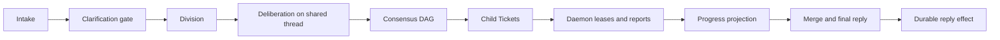

# Super-agent gaps beyond the article

Source material is the DeepSeek Harness Super-agent article: [the article page](https://haowenji.com/articles/x-2116829218935857152) with its [source post](https://x.com/DeepSeekHarness/status/2116857257245987236). This document tracks the article's §8 open problems and product or engineering pain points implied by those problems. “Implemented” refers to code present in this worktree. Open design proposals and code status are stated separately from live-service acceptance.

## §8.1 — Scaling the two-layer architecture

| Open problem | Why it is hard | Design direction and trade-off | Implemented? Evidence and owner |
|---|---|---|---|
| Decide when and how to shard the Router | One long-lived Router preserves shared context, but creates a throughput and failure concentration point. Sharding improves parallelism while splitting history and complicating ordering. | Measure arrival rate, queue delay, batch size and per-decision latency before sharding. Keep a single Router until measurements show a real limit; sharding then needs explicit partition and merge rules. | **Yes (configurable shard threshold).** At or below `AUTONOMY_ROUTER_SHARD_THRESHOLD` (default 32) a user's Eval batches stay on one Router session; above it they split across sessions capped by `AUTONOMY_ROUTER_MAX_SHARDS` (default 4), with stable per-batch shard assignment (`src/server/services/autonomy/shard.py`, `router.py`, `evals.py`, migration 122). The threshold is configuration-derived, not a calibrated live measurement. Owner: `feat/superagent-align`. |
| Define when peer Workers should communicate and which topology to use | Direct communication can reduce handoff time but increases coordination traffic, duplicate work and permission crossings. | Begin with Router-mediated reports and explicit Ticket subscriptions. Add peer links only for workflows where shared artifacts and ownership rules are explicit. | **Yes (bounded peer channel).** Workers send same-user peer messages and consume them from an inbox bounded by `AUTONOMY_PEER_CHANNEL_CAPACITY` (default 32) through `autonomy_peer_send`/`autonomy_peer_inbox` (`src/server/services/autonomy/peer_channel.py`, `host.py`, `src/tools/autonomy/tools.py`, migration 122). Peer text is data, not authority; no cross-instance topology. Owner: `feat/superagent-align`. |
| Co-design or train a model for Router work | Router decisions combine event classification, batching, memory retrieval and dispatch. General-purpose model behavior can vary by prompt and model version. | Keep decisions auditable and tool-bounded; benchmark prompts and model variants before specialized training. Specialized models may improve throughput but increase model maintenance and routing lock-in. | **No.** General model routing exists; there is no Router-specific training or comparative evaluation. Owner: `feat/superagent-align`. |
| Keep long-term memory useful after months of history | More history improves recall but raises retrieval cost, stale-context risk, privacy scope and summary drift. | Keep durable references and retrieve bounded relevant slices. Add retention, summarization provenance and deletion rules before growing the global history. | **No (partial memory mechanisms exist).** Ticket/Trigger references and bounded context snapshots exist (`evals.py`, `router.py`, `host.py`). PTC also has thread memory and compaction support (`src/ptc_agent/agent/middleware/runtime_context/`, `src/ptc_agent/agent/middleware/compaction/`). There is no demonstrated cross-Ticket, months-long memory quality or retention evaluation. Owner: `feat/superagent-align`. |
| Prevent Router batching from becoming a bottleneck | A single Router must process events quickly enough without dropping ordering or context. | Batch compatible events, but cap wait time and size; measure queue delay as well as model time. | **Yes (bounded batching; offline modeled measurements).** Per-user Eval batching was exercised against five seeded Poisson traces at each configured rate and a matched unbatched baseline. The fake model shows how batching changes virtual queue and amortized service measures under its declared assumptions; it gives no real-model latency or capacity evidence. No shard threshold is established. See `superagent-router-stress`. Owner: `feat/sa-experiments`. |

## §8.2 — Working with an agent without sessions

| Open problem | Why it is hard | Design direction and trade-off | Implemented? Evidence and owner |
|---|---|---|---|
| Present tasks without exposing execution sessions as the main product object | Users need durable status, ownership, files and history, while one task may use several threads and a single thread may receive follow-ups. | Use Ticket as the task record and show Worker thread/run details only when useful. This improves task continuity but requires consistent projections and links. | **Yes.** A person creates a task (`POST /api/v1/autonomy/tasks`), tracks its activity (`GET /api/v1/autonomy/tickets/{id}/activity`), and closes it (`POST /api/v1/autonomy/tickets/{id}/close`). An instruction is stored on the task when no worker session exists and is included when that session starts. Ticket detail is that record; the worker stream is an execution log (`task_interaction.py`, autonomy web routes). No sessionless interaction study was run. Owner: `feat/superagent-align`. |
| Support work-domain-specific interaction | GitHub review, Feishu chat, scheduled work and manual tasks need different input and approval surfaces. A single chat surface loses domain context. | Keep channel adapters but normalize durable Trigger/Ticket state; preserve original source links and source-specific approval. The trade-off is more adapters and policy combinations. | **Yes (explicit channel model).** One Trigger/Ticket model, one channel model: `src/server/services/autonomy/channels.py` names each channel's family, transport, reply limits, formatting and approval rules, and every reply resolves through it (`replies.py`). GitHub, Feishu, Slack, email and the local inbox each get their own reply form — IM caps a reply at 100 words and drops progress updates, asynchronous channels carry structured sections, and an email draft waits in the approval queue until a person reads it. Real Feishu tenant validation is not established; email and Slack Sources are API-only in this port and have no inbound poller yet. Owner: `feat/superagent-align`. |
| Let a person intervene during background execution | A human can change scope or stop work while the Worker or local process is active; server state and process state can diverge. | Use durable input/cancel intents acknowledged by the actual runner. This adds lease and delivery state but avoids reporting a stopped task while a process continues. | **Yes (durable input and verified stop paths).** Inputs are persisted and delivered or pulled by daemon workers. A stop is a durable request; a native daemon acknowledges after killing and verifying its CLI process tree, and the server records verified/unverified with a timeout escalation (`src/server/database/autonomy/stops.py`, `scripts/conductor_local_daemon.py`). Native process timing and independent endpoint authorization remain unverified here. Owner: `feat/cancel-followup`. |
| Support takeover and collaborative work | A human and agent may edit the same files or continue the same conversation at once. | Define one shared Thread owner and ordered inputs, or isolate edits and reconcile them. Shared state is convenient but expands conflict and permission risks. | **Yes (bounded takeover lifecycle).** Tickets subscribe as owner or context; Workers receive bounded shared Thread context, hand back out-of-scope follow-ups, and can `autonomy_unsubscribe`. The Router `autonomy_reassign`s a Thread to another live Ticket, moving its undelivered inputs and recording a durable handoff with the previous owner's latest report (migration 127). General multi-editor ordering on one Ticket remains open. Owner: `feat/shared-thread`. |
| Customize workflows without weakening common guarantees | Domain-specific customization can alter authority, retries, context and approvals in ways generic infrastructure cannot infer. | Keep policy and capability boundaries in the platform; allow workflow-specific presentation and routing within those bounds. | **No (Source policy exists).** There is no general workflow customization contract in this scope; source identifiers and Eval deadline metadata are a separate `feat/ticket-source-router` change. Owner: `feat/superagent-align`. |

## §8.3 — Context boundaries and A2A

| Open problem | Why it is hard | Design direction and trade-off | Implemented? Evidence and owner |
|---|---|---|---|
| Decide which teams share one Super-agent and which get separate instances | A shared instance improves recall and reduces duplicated work, but creates broad access to source events, files, credentials and history. | Use separate users/computers/accounts for hard isolation; share only contexts with a documented owner and data policy. This costs more setup and duplicates some state. | **Yes (server-side context boundary).** Every Ticket names one `isolated` or `shared` scope; isolated is the default and shared scopes carry an explicit policy (data classes, A2A, cross-user mapping, participant cap). `context_scope.py`, `context_scopes.py`, migration 128. Workspace routing is not an isolation boundary, and same-computer OS/credential isolation still requires separate computers or accounts. Owner: `feat/superagent-align`. |
| Let agents across boundaries exchange work securely | Neither side can assume the other's permissions, data quality, identity or retention rules. | Define a narrow message contract with provenance, audience, allowed actions, expiry and an explicit user/account mapping. Avoid raw shared memory. | **Yes (A2A v1, server-local).** A per-Ticket bearer agent credential authenticates `POST /api/v1/autonomy/a2a/messages`; an HMAC over the canonical envelope protects body integrity; the schema forbids unknown fields and bounds size, lifetime and allowed actions; both Tickets must name the same shared scope with A2A enabled and a permitted user mapping; delivery is one context-only Input with replay idempotency. `a2a.py`, `app/autonomy.py`. No discovery/federation handshake or multi-hop relay. Owner: `feat/superagent-align`. |
| Preserve provenance and authority when sharing context | A forwarded message may look like an instruction even if it was untrusted input or a read-only observation. | Carry source identity and trust label as structured fields; keep data separate from authority and require local policy to approve actions. | **Yes (structured and advisory).** The stored row and rendered Input carry source agent/ticket/user, thread, actor, trust=`untrusted`, intent, allowed actions and expiry. The server derives sender identity from the credential, not the body, and the message cannot change the recipient's status; `allowed_actions` are advisory and local policy still gates execution. Owner: `feat/superagent-align`. |
| Prevent context leaks across workers and workspaces | Separate threads do not isolate a shared machine's files, environment or credentials. | Give local daemon Workers explicit per-workspace roots, environment allowlists and OS process boundaries; refuse execution when the profile or supported boundary is unavailable. Refuse cloud autonomy launch/resume while its shared runtime cannot honor the same contract, and keep daemon follow-ups pull-only. Ordinary interactive chat keeps its existing trust semantics. Separate computers/accounts remain appropriate for broader hostile-tenant boundaries. | **Yes for context rows, plus worker process isolation; same-computer OS isolation unchanged.** Shared-context assembly and scoped reads filter sibling Tickets, reports and context-only Threads to the current scope, and context delivery is scope-filtered in SQL (`shared_context.py`, `host.py`, `database/autonomy/tickets.py`). Local native Worker process/ACP isolation, fail-closed cloud launch/resume, and daemon pull-only follow-ups are implemented in `src/llms/native_cli/isolation.py`, `src/server/services/autonomy/worker.py`, `inputs.py`, `src/server/app/autonomy.py`, and `src/server/database/autonomy/tickets.py`; the contract and validation boundary are documented in [`ports/worker-isolation.md`](ports/worker-isolation.md). Ordinary interactive chat, arbitrary external daemons, host administrator/kernel compromise, and whole-product tenant/network isolation remain outside scope. Same-computer files, OS user and MCP credentials remain shared, so hostile tenants still need separate computers/accounts. Owner: `feat/superagent-align`. |

## §8.4 — Security and privacy

| Open problem | Why it is hard | Design direction and trade-off | Implemented? Evidence and owner |
|---|---|---|---|
| Treat external events as untrusted and contain prompt injection | Event filters can decide whether a message is relevant, but cannot make its instructions safe. The Router and Worker may see the same hostile text through different paths. | Preserve raw source text for audit, but give models a structured untrusted-data boundary and explicit instruction not to follow embedded commands. Test Router and Worker paths independently. | **Yes (prompt boundary, not a guarantee).** Source redaction is in `src/server/services/autonomy/security.py`, `github.py`, `feishu.py`. Router instructions are in `router.py`/`evals.py`; Worker startup and input boundaries are in `worker.py`/`inputs.py`. These instructions do not establish injection resistance. Owner: `feat/superagent-align`. |
| Let a model use credentials without seeing them | If a credential is formatted into a prompt, tool result, error or transcript, normal model execution can disclose it. | Keep credentials in a request broker that performs only the allowed provider operation and returns a bounded result. Avoid returning the raw credential to calling code; redact known values from error and source text. The trade-off is less flexibility for arbitrary model-directed API calls. | **Yes (bounded GitHub operations).** `GitHubCredentialBroker` in `github.py` keeps vault plaintext inside GET/POST requests; Feishu auth stays inside the host CLI; the email and Slack credentials are revealed from the vault at send time and never travel with the message (`email.py`, `slack.py`). This is not a general model-call capability broker and does not prove all future paths safe. Owner: `feat/superagent-align`. |
| Constrain where a credential can be used | A broker that accepts arbitrary URLs or arbitrary methods can still be used to exfiltrate a secret. Enterprise GitHub endpoints complicate strict host allowlists. | Bind each credential to provider, account/source, operation and validated destination. Make custom enterprise hosts explicit and HTTPS-only, with loopback-only HTTP reserved for local tests. | **Yes (per-credential destination allowlist).** The GitHub credential broker now enforces a per-credential allowlist of hosts, HTTP methods and API-relative path prefixes before it reads the vault; an empty allowlist dimension denies, and every denial is a structured audit record (`event=credential_denied`) carrying the credential name, user id, method, host, path, reason and policy version — never the secret value (`src/server/services/autonomy/credentials.py`, `github.py`). The default scope is the Source's `api_base_url` host plus the GET/POST operations the adapter uses; an explicit `credential_allowlist` may narrow it. HTTPS is required except loopback HTTP; redirects, URL credentials, query data, encoded paths and dot segments are refused. Enterprise hosts remain an explicit operator trust decision, and there is no signed per-call capability. Owner: `feat/beyond-cred-scope`. |
| Protect endpoint devices from a compromised cloud agent | Cloud workers and endpoint daemons cross a major trust boundary; a broad daemon API can turn cloud compromise into endpoint execution. | Keep the endpoint responsible for local authorization, expose a narrow operation set, bind requests to an expiring lease and verify origin. The trade-off is extra protocol and recovery state. | **No (partial lease and owner checks exist).** Daemon identity, provider, ownership and lease fences restrict work, with cancellation observation on local CLI workers. Signed capabilities and independent local authorization remain deferred. Owner: `feat/daemon-lease`. |
| Limit blast radius of server or prompt compromise | A shared account, computer or credential can expose many workspaces and endpoint devices. | Apply per-workspace OS process and environment boundaries to local autonomous Workers, fail closed on missing/unsupported profiles, keep daemon work pull-only, and refuse cloud Worker execution until its runtime can enforce an equivalent scope. Use separate computers/accounts for product-wide hostile boundaries and narrow Source credentials. Isolation adds profile maintenance and can reject launches on unsupported hosts. | **Partial.** Local native Worker launches are scoped, cloud autonomy launch/resume fail closed, and daemon replies remain pull-only (`src/llms/native_cli/isolation.py`, `src/server/services/autonomy/worker.py`, `inputs.py`, `src/server/app/autonomy.py`, `src/server/database/autonomy/tickets.py`). This does not establish whole-product tenant/network isolation or independent authorization on every arbitrary endpoint. See [`ports/worker-isolation.md`](ports/worker-isolation.md). Owner: `feat/superagent-align`. |
| Keep privacy while retaining cross-environment recall | Broad memory helps the Router but can combine personal, team and endpoint data across scopes. | Store references and retrieve only policy-approved slices. Define retention and deletion at the same boundary as access. | **No (bounded retrieval exists).** Snapshots and explicit reads exist, as does PTC thread memory/compaction; no comprehensive cross-instance privacy/retention model. Owner: `feat/superagent-align`. |
| Make security behavior auditable | Redaction, policy changes, retries and endpoint runs need evidence without logging credentials or private content. | Record source IDs, policy versions, decisions, credential names (never values), capability outcomes and redacted error codes. | **No (durable state exists).** Policy versions and Ticket/effect records exist; a unified security audit record is not implemented. Owner: `feat/superagent-align`. |

## Context scopes and authenticated A2A

**Context scope.** A Ticket always names a scope. `isolated` is the default and is created with the Ticket; it exposes only that Ticket's own rows. `shared` is an explicit grant with a validated policy: which data classes cross (`triggers`, `reports`, `tickets`, `a2a_messages`), whether A2A is allowed, whether another account may join, a participant cap and a retention hint. Moving a Ticket into a shared scope is a separate, ownership-checked action; a Ticket already in one shared scope cannot be silently moved to another. Shared-context assembly and Worker reads filter by the scope and by the exact data class, so publishing Tickets never exposes Reports (or the reverse). Intake delivery reaches only context subscribers in the same shared scope, and subscribing requires that scope to publish `triggers`. A thread name or workspace id alone grants nothing.

**A2A protocol.** An A2A agent is a bearer credential bound to one active Ticket; only its SHA-256 digest is stored. The wire contract is `conductor.a2a/1`: `message_id`, sender and recipient Ticket ids, intent (`inform`, `request_review`, `handoff_request`), subject/body, advisory `allowed_actions`, provenance (source id/thread/actor and trust=`untrusted`), `issued_at` and `expires_at`. The schema forbids unknown fields and bounds body size (8 KB), action count, duplicate actions and lifetime (24 h). A request presents `Authorization: Bearer …` plus `X-A2A-Signature`, an HMAC-SHA256 over canonical JSON using that token; the server compares it in constant time, requires the envelope sender to equal the authenticated Ticket, rejects stale (5 min clock window) and expired messages, and requires one shared scope with `allow_a2a` and a permitted user mapping. A message is recorded and delivered as one `kind="context"` Input in a single transaction; replay of the same `message_id` returns the existing row without a second Input, while a changed payload is a conflict. Stored and rendered subject, body and provenance are credential-redacted, and the message never edits Ticket status or authority. The bearer routes are feature-gated after token authentication, so disabling `super_agent` also stops an already-issued credential.

**Trade-offs and boundary.** Scopes are server-local: there is no discovery or federation handshake between Conductor instances, no multi-hop relay and no signed per-action capability. A2A is deliberately context-only; a `handoff_request` still requires the receiving side or its local policy to act. Same-computer workspaces continue to share an OS user, files and MCP credentials, so scopes do not turn them into hostile-tenant isolation.

**References.** `src/server/services/autonomy/context_scope.py`, `src/server/database/autonomy/context_scopes.py`, `src/server/services/autonomy/shared_context.py`, `src/server/services/autonomy/a2a.py`, `src/server/database/autonomy/a2a.py`, `src/server/app/autonomy.py`, and `migrations/versions/128_context_scopes_a2a.py`. Focused tests: `tests/unit/server/services/autonomy/test_context_scope.py`, `test_a2a_protocol.py`, `tests/unit/server/test_autonomy_a2a_api.py`, `tests/unit/server/database/test_autonomy_context_scopes.py`, and `tests/unit/migrations/test_128_context_scopes_a2a.py`.

## Implied operational pain points

| Pain point | Why it matters | Direction and trade-off | Implemented? Evidence and owner |
|---|---|---|---|
| Router startup noise and prompt quality | A long-lived Router can spend context on repeated setup or irrelevant activity before it reaches useful decisions. | Keep baseline context compact and measure decision quality after prompt changes. Less startup context can omit useful history. | **Partial (opt-in implementation; local evidence only).** Migration `123` adds per-user snapshots with generation checks and SHA-256 integrity checksums (not signatures), invalidated by PostgreSQL Source/policy triggers; best-effort per-Eval metrics are available at authenticated `/api/v1/metrics/router`. Timed-out writes can leave rows or fields absent, so these metrics are not complete-coverage counts. The default-off flag is `AUTONOMY_ROUTER_SNAPSHOT_ENABLED`. A deterministic fixture measured 10,633→1,485 prompt bytes (86.034%) when replacing bounded history with current-batch context; same-payload rendering measured 1,602→1,485 bytes (7.303%). The scoped offline suite passed 689 tests. No live PostgreSQL race, model-quality result, or 48-hour enabled rollout is established. Owner: `beyond-router-plan`. |
| Source policy changes while work is active | A task accepted under one policy may become unauthorized after a Source, sender or mode changes. | Revalidate the mandate before retry and surface a durable policy notice. This can cancel work that was previously valid, but keeps current policy authoritative. | **Yes.** `src/server/services/autonomy/policy.py`, `host.py` and policy tests revalidate and notify. No live mutation test was run in this task. Owner: `feat/superagent-align`. |
| Queue fairness and starvation | A global slot cap prevents overload but may let a noisy Source dominate worker slots. | Add per-user/source quotas and aging only after metrics show unfairness; quotas can leave capacity idle. | **No (global slot cap exists).** Global slots and backlog metrics exist (`worker.py`, `database/autonomy/metrics.py`); no fairness quota is present. Owner: `feat/superagent-align`. |
| Partial completion and external side effects | A remote comment may be posted while local acknowledgement fails, causing retries or duplicate posts. | Use idempotency markers and destination reconciliation; this adds provider-specific state and can still be limited by API behavior. | **Yes (bounded provider handling).** Every outbound reply surfaces its outbox idempotency key at the destination — a hashed marker comment on GitHub, a marker line on Feishu, a deterministic `Message-ID` on email — and the delivery effect reconciles against the destination before re-sending: a retry after "remote commit, local ack lost" settles `sent` without a duplicate post (`replies.py`, `github.py`, `feishu.py`, `email.py`; fake-transport tests in `test_outbox_side_effects.py`). Feishu read-back failure refuses to send (retries the effect) rather than guessing. Slack's incoming webhook is write-only and email has no Sent-folder scan here, so those two stay at-least-once, narrowed only by the key they carry; no live external post was performed here. Owner: `feat/beyond-side-effects`. |
| Change evidence and release claims drift from code | Historical pilots, skipped migrations and tests on another commit can be mistaken for current acceptance. | Record exact branch/head, tests, migrations and live checks separately. This adds reporting work but prevents unsupported claims. | **Yes (documentation).** This document and `SUPER-AGENT-ALIGNMENT.md` make the evidence boundary explicit; native, production, and multi-worker fault-injection acceptance remain unverified. Owner: `feat/superagent-align`. |

## Current acceptance boundary

Verification limits are in the internal document `ROUND2-INTEGRATION-REPORT` (not published). The integration exercised an isolated two-worker backend, private Postgres/Redis, ordinary daemon HTTP claims/reports with mock workers, deterministic LLM responses, and a loopback GitHub fixture. It did not run native CLI daemons, contact external GitHub/Feishu, deploy to production, or run the separate multi-worker fault-injection gate. The later native-daemon stop verification described above was tested with fake runtimes and focused unit tests (833 passed, 1 skipped in the touched suite), not a live CLI process.

## Speculative observe outcomes (§3.4)

**Problem.** An observe run could finish as a waiting plan or a quiet drop, but the conclusion lived only in the Ticket summary. A dropped run clears that summary, so the Router could not tell an accepted plan from a discarded one, and a later signal on the same Thread could start another observe.

**Why it is hard.** Useful results have to stay reviewable without becoming a relay. Quiet results have to stay quiet and still keep evidence. A person's approve must launch real work without erasing the plan that justified it. Reusing an open plan must not downgrade an owned subscription or launch a second Worker.

**Design and trade-offs.** The mandate stores `speculative_outcome` with `accepted`, `discarded`, or `approved`, plus bounded Worker evidence and the report id. PTC and daemon reports write the same record. Discard completes a waiting, blocked, or failed speculative Ticket without a relay. Approve clears the speculative flag, keeps the evidence, and launches the executing Worker. The Router inlines the record, recall previews it, and an inferred observe accept attaches the new signal as context on an open accepted plan instead of launching again. Observe still does not edit files; approval is the execution boundary.

**Implemented: Yes.** Focused unit tests cover PTC and daemon settlement, evidence bounds, approve, discard, thread context, recall, and reuse. The ticket detail shows the outcome and can discard a plan. No live provider run or native CLI acceptance was added here.

**References.** `src/server/services/autonomy/host.py`, `src/server/services/autonomy/context.py`, `src/server/services/autonomy/router.py`, `src/server/database/autonomy/daemons.py`, `src/server/app/autonomy.py`, and `web/src/features/superagent/shared.tsx`.

## Clarification before execution

**Problem.** A vague request can launch a worker on the wrong goal. Clarifying after launch wastes a worker slot and repeats paid work. The gate must pause before execution and resume the same Ticket after a user confirms or edits the proposed goal.

**Why it is hard.** Clarity depends on the source and user, so one score threshold creates both unnecessary questions and missed ambiguity. Manual, GitHub, and Feishu intake have different confirmation surfaces. A UI confirmation can race a channel reply, and separate backend workers must still produce one resume and one launch.

**Design and trade-offs.** The design combines a deterministic heuristic with a mockable `Clarifier` protocol and an optional LLM slow path. A durable clarification row stores the draft and questions. Creation holds the Ticket before assessment; confirmation row-locks the Ticket and active draft, then saves the edited scope, answer, resolution, and launch effect in one transaction. A duplicate confirmation cannot add another answer or launch. Channel sources receive a question on the source thread; manual work uses the UI. The feature defaults off for legacy intake and can be explicitly enabled by Main Agent. Public channel questions may expose the draft to bystanders, and unanswered Tickets do not expire automatically.

**Implemented: Yes.** The gate is controlled by `AUTONOMY_CLARIFY_ENABLED` and `AUTONOMY_CLARIFY_THRESHOLD`, backed by migration 115. Manual, GitHub, and Feishu intake create held Tickets when enabled; Main Agent calls the same gate with an explicit enabled override and confirms with `enqueue_launch=False` so the orchestration root never enters the worker queue. Focused unit checks, private PostgreSQL race/rollback checks, and the HTTP run verify the mechanism. Native daemon confirmation was not exercised.

**References.** `src/server/services/autonomy/clarify.py`, `src/server/app/autonomy.py`, `migrations/versions/115_clarification_gate.py`, and the [original clarification-gate design](beyond/CLARIFICATION-GATE.md).

## Deliberation before execution

**Problem.** Independent agents can otherwise start from different assumptions and produce conflicting edits. Before execution, participants need to propose and critique a plan, then hand one agreed plan or a planner decision with recorded dissent to the task DAG.

**Why it is hard.** Consensus can deadlock, so a bounded round count must still yield one plan without erasing disagreement. Participants may be different local CLIs. In daemon mode, each bounded participant turn uses an ordinary Ticket claim and must release capacity when that turn reports; it must not hold a lease while waiting for later DAG execution. Durable state must survive multiple backend workers and restarts without directly mutating thread tables owned by other subsystems.

**Design and trade-offs.** A durable state machine stores participants, rounds, messages, votes, dissent, and DAG steps. Participants propose in the first round and critique or revise later. A planner synthesizes the result and closes at consensus or `max_rounds`. Mock participants use deterministic adapters for repeatable tests; LLM mode uses the configured model, and daemon mode uses participant Tickets and ordinary daemon leases. The planner synthesis follows its configured adapter, so live LLM/daemon runs preserve participant input at the cost of model or daemon work. The thread port keeps transcript persistence separate from thread ownership. Execution child Tickets are created only after consensus planning finishes.

**Implemented: Yes.** The integrated service supplies bounded rounds, durable proposals/votes/dissent, deterministic mock participants, local CLI and daemon adapters, thread-port persistence, and cyclic-DAG validation. Main Agent carries the original divided subquestions, descriptions, and agent assignments into each persisted deliberation objective; the private HTTP run compared that payload to the durable division snapshot. Local CLI and native daemon deliberation remain unverified.

**References.** `src/server/services/deliberation/`, `src/server/app/deliberation.py`, `migrations/versions/114_deliberation.py`, and the [original deliberation design](beyond/DELIBERATION.md).

## Verified stop for native daemons

**Problem.** A user can stop a running Ticket, but cancellation of server state does not prove the native CLI on their machine exited. Reporting a stop without that proof leaves an orphaned process that can keep editing files or calling external services.

**Why it is hard.** The backend and the endpoint daemon are separate processes; a response can be lost, a daemon can die after cancelling, or the CLI can leave MCP/tool children in its session. Verification must be durable, ordered against lease heartbeats, and time-bounded without claiming more than the daemon can attest.

**Design and trade-offs.** A stop request is persisted before the Ticket is cancelled and records the owning daemon, lease, mode, deadline and evidence. A native daemon polls the Ticket status, cancels its CLI task, confirms the leader and its process group exited, then acknowledges with non-secret process evidence. The server accepts the acknowledgement only if the Ticket cancellation is persisted, the lease and daemon match, and no heartbeat renewed the lease after the request; it then clears the lease and records `verified`. A lease-loss path re-reads the Ticket so a heartbeat watcher that notices cancellation first still acknowledges the stop. A missing or negative acknowledgement is recorded `unverified`, revokes the lease, and raises an Inbox attention item; the scheduler escalates past-deadline requests. This is a daemon attestation plus server-side state checks, not independent inspection of the user's machine; a compromised daemon token can lie. PTC backend workers have no native acknowledgement and are recorded `not_applicable`.

**Implemented: Yes.** `src/server/services/autonomy/stop.py` orchestrates the request; `src/server/database/autonomy/stops.py` persists and verifies it; `scripts/conductor_local_daemon.py` acknowledges with `ProcessTracker` evidence from `src/llms/native_cli/process.py`; migration 124 adds the table and the last-heartbeat column. `TicketView.stop` surfaces mode, verification, evidence and timestamps through ticket list/detail and the stop response.

**References.** `src/server/services/autonomy/stop.py`, `src/server/database/autonomy/stops.py`, `src/server/app/autonomy.py`, `scripts/conductor_local_daemon.py`, `src/llms/native_cli/process.py`, `migrations/versions/124_verified_stop.py`, and the tests under `tests/unit/server/database/test_autonomy_stops.py`, `tests/unit/server/test_autonomy_stop_api.py`, `tests/unit/server/services/autonomy/test_verified_stop.py`, `tests/unit/llms/test_native_cli_process_tracker.py`, and `tests/unit/scripts/test_conductor_local_daemon.py`.

**Verification limit.** The path is covered with fake daemon adapters and focused unit tests. No live native CLI daemon was stopped, no production database migration was applied, and no real timeout escalation was exercised in this worktree.

## Main Agent orchestration and execution bridge

**Problem.** Durable planning needs to coordinate clarification, deliberation, DAG scheduling, worker progress, result merging, and a final reply. The coordinator must not silently become an executor. Its tasks also need a durable, observable route to the existing daemon execution system.

**Why it is hard.** Main Agent run/task claims and autonomy Ticket daemon leases are separate persistence and API contracts. Planning, worker callbacks, outbox advancement, and daemon claims may reach different backend workers. A root orchestration Ticket must remain unavailable to daemons while child Tickets preserve the source, workspace, provider, and ownership boundaries. A stale or partial worker report must not produce a completed run.

**Design and trade-offs.** Main Agent owns the root run and DAG. Ready DAG nodes bridge to daemon-eligible child Tickets, which use the existing lease, heartbeat, and report protocol. Postgres stores durable state; compare-and-swap transitions and claim fencing prevent stale writers from overwriting newer work. Bounded scheduler effects advance settled runs. This reuses daemon controls but adds a mapping between run tasks and child Tickets that must be recovered and reconciled. SQLite remains for offline service demos, not production.

**Implemented: Yes.** The service provides dependency-injected stages and authenticated REST routes. Its orchestration-only root Ticket bridges ready DAG nodes to durable daemon-claimable child Tickets, and report synchronization projects terminal child state back into the run and deliberation transcript. The private HTTP run verified this bridge with ordinary daemon claim/report endpoints. It used mock daemon workers and a deterministic LLM adapter, so it does not prove native CLI execution or production readiness.

**References.** `src/server/services/main_agent/`, `src/server/app/main_agent.py`, `src/server/database/main_agent.py`, `src/server/database/main_agent_bridge.py`, `scripts/main_agent_demo.py`, and the [original Main Agent contract](beyond/MAIN-AGENT-SPEC.md).

## Unsubscribe and reassignment lifecycle

**Problem.** A subscription that never ends keeps routing follow-ups to a Ticket that is done, blocked on the wrong owner, or out of scope. Without reassignment, moving a Thread to a better owner means cancelling work and losing its progress state.

**Why it is hard.** Subscription state is read on every intake decision across backend workers, so the end must be durable before the route changes, and a retried unsubscribe or reassignment must not double-end or double-deliver. The new owner needs the old owner's progress or it restarts cold, and inputs already queued for the old owner must not leak onto its Worker after the move.

**Design and trade-offs.** A subscription row gets an end (`ended_at`/`end_reason`: unsubscribed, reassigned, ticket-ended) instead of being deleted, so the audit trail survives. Terminal Ticket transitions end subscriptions in the same write (including the fenced daemon-report transaction), making "the row is the lifecycle" hold for every writer. A Worker ends one subscription with `autonomy_unsubscribe`; the Router moves a Thread with `autonomy_reassign`, which ends the source subscription, reactivates the target's, moves the Thread's undelivered inputs, and appends an `autonomy_handoffs` record carrying the previous owner's latest report. The target surfaces handoffs in its launch context and ticket reads; a delivery effect enqueued before a move skips when the input no longer belongs to its payload's Ticket. The trade-off is extra lifecycle state per subscription; the routing rule stays one query.

**Implemented: Yes.** Migration 127 chains after 126 and is reversible. Unit tests cover the SQL guards, both tool surfaces, the intake fall-through, and the stale-delivery skip. Native daemon and live multi-owner reassignment were not exercised here.

**References.** `src/server/services/autonomy/host.py`, `src/server/database/autonomy/tickets.py`, `src/server/database/autonomy/daemons.py`, `src/server/services/autonomy/shared_context.py`, `src/tools/autonomy/tools.py`, `migrations/versions/127_subscription_lifecycle.py`.

## Execution flow

Every approved DAG step remains in durable Postgres state. Its projected row carries the linked child Ticket ID, daemon ID, and current state. The orchestration root is never daemon-claimable; successful reconciliation completes it after child reports and final reply persistence.

## Verification record

The private acceptance runner passed against a two-worker backend on `127.0.0.1:18080`, PostgreSQL database `conductor_acceptance` on private port `55439` (migrations through 117), and Redis database 0 on private port `56379`. The backend used an injected deterministic LLM adapter. Five concurrent runs included one ambiguous request and four clear synthetic artifact requests. The gate paused the ambiguous run until its edited objective was confirmed. The run completed 15 DAG tasks, including codex/kimi/grok mock deliberation with one recorded Grok dissent. Three ordinary HTTP daemon claims overlapped. All five root Tickets and all 15 child Tickets completed; every persisted deliberation step matched its task's child Ticket and terminal status. Parsed persisted deliberation objectives also matched each run's original division snapshot for subquestion IDs, descriptions, and agent assignments. Five final replies were observed at the loopback GitHub fixture. The fixture also received the clarification prompt. No real GitHub request or post occurred.

The runner's sanitized receipt is internal audit evidence (not published). Native CLI daemons and live provider deliberation were not run. A separate concurrent PostgreSQL check verified that daemon claims return nothing while a slow clarification assessment holds a Ticket, duplicate gate checks create one draft, concurrent confirmations create one answer/effect, and failed effect insertion rolls back the confirmation transaction.

Focused validation passed 424 autonomy/database/deliberation/clarification/Main Agent/runner tests; an additional focused run passed 400 tests. The latest full unit snapshot passed 15,692 tests with 21 skipped. The clarification transaction integration passed twice on private PostgreSQL. Frontend validation passed `pnpm typecheck` and `pnpm test` (183 files, 1,531 tests). These are local results on the shared integration tree; no production deploy, native daemon acceptance, external GitHub post, or multi-worker fault-injection gate is claimed. See the internal document `ROUND2-INTEGRATION-REPORT` (not published) for commands, tree hashes, and evidence boundaries.

The §8.3 context-scope and A2A work was validated locally without a database or network: 399 focused autonomy/database/migration/status tests passed, with 694 database/layering tests, 290 model tests, and the full 246-test `tests/unit/migrations` suite also green and migration 119 as the single head. These are unit-level protocol and SQL-shape results, not multi-instance or hostile-tenant acceptance.
