# Stage-Gate port

Owner: PRD 05 (StepFun). Module: `src/server/services/autonomy/stage_gate.py`.
Tests: `tests/unit/server/services/autonomy/test_stage_gate.py`.

This is the pure half of the Stage-Gate policy in
`docs/SUBAGENT-ORCHESTRATION.md` ("Task lifecycle" and "Gates and failure
policy"). v1 ships the state machine and its audit shape only: no scheduler, no
Ticket, no effects, no database, no migration. The next section says exactly
where those hooks go.

## 1. Contract

`advance(state, event) -> Transition` is a **total, pure function**:

- it reads no clock and does no IO, so the same `(state, event)` pair always
  produces the same answer;
- the caller owns time and passes `event.timestamp`;
- an illegal transition is *answered*, not thrown: `Transition.accepted` is
  `False`, the state comes back untouched, no `GateEvent` is produced, and
  `Transition.reason` carries a stable code;
- only an accepted transition produces a `GateEvent`, and that record is a fixed
  field whitelist with no prompt, token or diff content.

Roles arrive as plain provider strings on the `Event` (`provider`, `verdict`,
`conflict`, `option`). The module deliberately does **not** import `roles` or
`role_plan`, so PRD 03 can change those files without touching this one. The
caller builds the `Event` from whatever the assignment planner returned.

What the caller keeps, not the machine: `GateResult.reason` and
`GateResult.evidence` (the reviewer's own words) stay with the caller, which is
what v2 writes next to the event. The machine only records its own stable
reason code.

## 2. State diagram

```mermaid
stateDiagram-v2
    [*] --> planning
    planning --> spec_review : spec_submitted
    spec_review --> dag_ready : G0 pass
    spec_review --> replanning : G0 fail (spec_rejected)
    dag_ready --> assigned : assign
    dag_ready --> replanning : reject_dag (D1 milestone, invalid DAG)
    assigned --> implementing : start_implementation
    assigned --> assigned : reassign (checkpoint, handoff required)
    implementing --> focused_tests : submit_work
    implementing --> implementing : reassign REFUSED
    focused_tests --> primary_review : G2 pass
    focused_tests --> fixing : G2 fail
    primary_review --> secondary_review : approve
    primary_review --> integration_checks : merge, not risk-bearing
    primary_review --> fixing : block (initial, or 1st failed fix round)
    primary_review --> replanning : block, 2nd failed fix round
    fixing --> focused_tests : fix_resubmitted (return_stage)
    fixing --> primary_review : fix_resubmitted (return_stage)
    fixing --> secondary_review : fix_resubmitted (return_stage)
    fixing --> assigned : reassign (checkpoint after BLOCK)
    secondary_review --> integration_checks : approve
    secondary_review --> fixing : block (initial, or 1st failed fix round)
    secondary_review --> replanning : block, 2nd failed fix round
    secondary_review --> replanning : ordinary conflict
    secondary_review --> awaiting_adjudication : scope / security conflict
    awaiting_adjudication --> fixing : maintain_block (ordinary BLOCK)
    awaiting_adjudication --> replanning : maintain_block, 2nd failed round
    awaiting_adjudication --> secondary_review : overturn_block, secondary owed
    awaiting_adjudication --> integration_checks : overturn_block, both reviews done
    integration_checks --> awaiting_human : G5 pass
    integration_checks --> blocked : G5 fail
    awaiting_human --> merged : G6 approve
    awaiting_human --> replanning : G6 reject
    replanning --> planning : resplit_task
    replanning --> assigned : replace_developer (handoff required)
    note right of blocked
        resume returns to state.blocked_from,
        or planning when nothing was recorded
    end note
    blocked --> assigned : reassign (not paused from implementing unless the worker exited; handoff required)
    blocked --> cancelled : cancel
    planning --> blocked : block
    spec_review --> blocked : block
    dag_ready --> blocked : block
    assigned --> blocked : block
    implementing --> blocked : block
    focused_tests --> blocked : block
    primary_review --> blocked : block
    fixing --> blocked : block
    secondary_review --> blocked : block
    integration_checks --> blocked : block
    awaiting_human --> blocked : block
    replanning --> blocked : block
    awaiting_adjudication --> blocked : block
    planning --> cancelled : cancel
    spec_review --> cancelled : cancel
    dag_ready --> cancelled : cancel
    assigned --> cancelled : cancel
    implementing --> cancelled : cancel
    focused_tests --> cancelled : cancel
    primary_review --> cancelled : cancel
    fixing --> cancelled : cancel
    secondary_review --> cancelled : cancel
    integration_checks --> cancelled : cancel
    awaiting_human --> cancelled : cancel
    replanning --> cancelled : cancel
    awaiting_adjudication --> cancelled : cancel
    merged --> [*]
    cancelled --> [*]
```



`block` and `cancel` are available from every non-terminal stage; only the
per-stage edges are drawn above so the diagram stays readable.

`awaiting_human` (G6 merge approval) and `awaiting_adjudication` (a reviewer
conflict waiting for a human decision) are deliberately separate states: G6 is
only reachable from a passing G5, so no conflict outcome — upheld or overturned —
can act as a merge approval or skip the dual review.

`resume` from `blocked` returns to `state.blocked_from`, the stage the task was
in when it was paused, and falls back to `planning` when nothing was recorded.

## 3. Stages and gates

| stage | gate | meaning |
| --- | --- | --- |
| `planning` | — | mission plan being written |
| `spec_review` | G0 | SPEC acceptance |
| `dag_ready` | D1 | task DAG published, not yet assigned. **D1 is a milestone, not a pass/fail gate**: an invalid DAG (cycle, missing dependency, write-scope conflict) is a planning failure and goes to `replanning` |
| `assigned` | — | developer named (dynamic scheduler) |
| `implementing` | — | work in flight; no swap allowed |
| `focused_tests` | G2 | focused tests for the changed surface |
| `primary_review` | — | primary review (Codex in the current roster) |
| `fixing` | — | developer addressing a BLOCK or a failed gate |
| `secondary_review` | — | review by another developer-pool model |
| `integration_checks` | G5 | full suite + single Alembic head |
| `awaiting_human` | G6 | human **merge approval**; only ever entered from a passing G5 |
| `awaiting_adjudication` | — | human **adjudication of a reviewer conflict**; a separate state so no conflict outcome can act as a merge approval |
| `merged` | — | terminal |
| `replanning` | — | planner owns the next move |
| `blocked` | — | paused by an operator or the planner |
| `cancelled` | — | terminal |

## 4. Transition table

Generated from the code by `stage_gate.render_transition_table()`;
`test_stage_gate.py::TestDocumentation` asserts every row is present here, so
this table cannot drift from the module.

| from | event | condition | to | reason | note |
| --- | --- | --- | --- | --- | --- |
| `planning` | `spec_submitted` | spec handed to review | `spec_review` | `spec_submitted` | planner publishes the mission plan |
| `spec_review` | `gate_result` | gate passes | `dag_ready` | `spec_accepted` | G0; a rejected spec goes back to the planner |
| `spec_review` | `gate_result` | gate fails | `replanning` | `spec_rejected` | G0; a rejected spec goes back to the planner |
| `dag_ready` | `assign` | developer named | `assigned` | `assigned` | D1 DAG plus the deterministic assignment |
| `dag_ready` | `reject_dag` | DAG invalid | `replanning` | `dag_invalid` | D1 is a milestone, not a pass/fail gate: a cyclic DAG, a missing dependency or a write-scope conflict is a planning failure |
| `assigned` | `start_implementation` | work begins | `implementing` | `implementation_started` | the developer starts on the assigned task |
| `assigned` | `reassign` | checkpoint swap | `assigned` | `developer_reassigned` | checkpoint: before entering review |
| `implementing` | `submit_work` | work + handoff published | `focused_tests` | `work_submitted` | implement + handoff, then G2 runs |
| `implementing` | `reassign` | always refused | — | `reassignment_not_at_checkpoint` | mid-implementation swaps are forbidden |
| `focused_tests` | `gate_result` | gate passes | `primary_review` | `focused_tests_passed` | G2 focused tests |
| `focused_tests` | `gate_result` | gate fails | `fixing` | `focused_tests_failed` | G2 focused tests |
| `primary_review` | `primary_review` | approve | `secondary_review` | `primary_review_passed` | Codex primary review; author may not review own code |
| `primary_review` | `primary_review` | merge, not risk-bearing | `integration_checks` | `primary_merge_no_risk` | Codex primary review; author may not review own code |
| `primary_review` | `primary_review` | block, initial (no failed fix round yet) | `fixing` | `review_blocked` | Codex primary review; author may not review own code |
| `primary_review` | `primary_review` | block, 1st failed fix round | `fixing` | `review_blocked` | Codex primary review; author may not review own code |
| `primary_review` | `primary_review` | block, 2nd failed fix round | `replanning` | `two_failed_rounds` | Codex primary review; author may not review own code |
| `fixing` | `submit_work` | fix published, tests rerun | `focused_tests` | `fix_resubmitted` | target is state.return_stage, the stage that blocked |
| `fixing` | `submit_work` | fix published, primary re-reviews | `primary_review` | `fix_resubmitted` | target is state.return_stage, the stage that blocked |
| `fixing` | `submit_work` | fix published, secondary re-reviews | `secondary_review` | `fix_resubmitted` | target is state.return_stage, the stage that blocked |
| `fixing` | `reassign` | checkpoint swap after BLOCK | `assigned` | `developer_reassigned` | checkpoint: after a BLOCK |
| `secondary_review` | `secondary_review` | approve | `integration_checks` | `secondary_review_passed` | another developer-pool model; author, contributors and primary may not take it |
| `secondary_review` | `secondary_review` | block, initial (no failed fix round yet) | `fixing` | `review_blocked` | another developer-pool model; author, contributors and primary may not take it |
| `secondary_review` | `secondary_review` | block, 1st failed fix round | `fixing` | `review_blocked` | another developer-pool model; author, contributors and primary may not take it |
| `secondary_review` | `secondary_review` | block, 2nd failed fix round | `replanning` | `two_failed_rounds` | another developer-pool model; author, contributors and primary may not take it |
| `secondary_review` | `secondary_review` | scope conflict | `awaiting_adjudication` | `reviewer_conflict_scope` | another developer-pool model; author, contributors and primary may not take it |
| `secondary_review` | `secondary_review` | security conflict | `awaiting_adjudication` | `reviewer_conflict_security` | another developer-pool model; author, contributors and primary may not take it |
| `secondary_review` | `secondary_review` | other conflict | `replanning` | `reviewer_conflict_planner` | another developer-pool model; author, contributors and primary may not take it |
| `awaiting_adjudication` | `adjudicate_conflict` | maintain_block, initial | `fixing` | `review_blocked` | a human decides the reviewer conflict; neither option waives the dual review or G5 |
| `awaiting_adjudication` | `adjudicate_conflict` | maintain_block, 1st failed fix round | `fixing` | `review_blocked` | a human decides the reviewer conflict; neither option waives the dual review or G5 |
| `awaiting_adjudication` | `adjudicate_conflict` | maintain_block, 2nd failed fix round | `replanning` | `two_failed_rounds` | a human decides the reviewer conflict; neither option waives the dual review or G5 |
| `awaiting_adjudication` | `adjudicate_conflict` | overturn_block, secondary still owed | `secondary_review` | `conflict_overturned` | a human decides the reviewer conflict; neither option waives the dual review or G5 |
| `awaiting_adjudication` | `adjudicate_conflict` | overturn_block, both reviews done | `integration_checks` | `conflict_overturned` | a human decides the reviewer conflict; neither option waives the dual review or G5 |
| `integration_checks` | `gate_result` | gate passes | `awaiting_human` | `integration_checks_passed` | G5 full suite + single Alembic head |
| `integration_checks` | `gate_result` | gate fails | `blocked` | `integration_checks_failed` | G5 full suite + single Alembic head |
| `awaiting_human` | `gate_result` | human approves | `merged` | `human_approved_merge` | G6 human merge approval; a risk-bearing change still needs both reviews to have passed |
| `awaiting_human` | `gate_result` | human rejects | `replanning` | `human_rejected` | G6 human merge approval; a risk-bearing change still needs both reviews to have passed |
| `replanning` | `replan_decision` | resplit_task | `planning` | `replanned_split` | caller picks one of state.replan_options |
| `replanning` | `replan_decision` | replace_developer | `assigned` | `developer_replaced` | caller picks one of state.replan_options |
| `blocked` | `resume` | origin recorded | `state.blocked_from` | `resumed` | target is state.blocked_from; `planning` when nothing was recorded |
| `blocked` | `reassign` | paused outside implementation, or after the worker exited | `assigned` | `developer_reassigned` | checkpoint: after a BLOCK; a pause from implementing needs option=worker_exited, else reassignment_not_at_checkpoint |
| `blocked` | `block` | always refused | — | `already_blocked` | the task is already paused |
| any non-terminal | `block` | operator or planner pause | `blocked` | `operator_blocked` | every non-terminal stage |
| any non-terminal | `cancel` | task abandoned | `cancelled` | `cancelled` | every non-terminal stage |

## 5. Reason codes

Generated by `stage_gate.render_reason_table()` and asserted against this
file by the same test. Codes are stable strings; nothing here is generated at
runtime by a model.

| reason | meaning |
| --- | --- |
| `spec_submitted` | plan handed to the G0 gate |
| `spec_accepted` | G0 passed |
| `spec_rejected` | G0 failed; the planner owns the next move |
| `assigned` | developer named for the D1 DAG |
| `developer_reassigned` | checkpoint swap, before review or after a BLOCK |
| `implementation_started` | developer began work |
| `work_submitted` | work plus handoff published for G2 |
| `focused_tests_passed` | G2 passed |
| `focused_tests_failed` | G2 failed; the developer fixes |
| `primary_review_passed` | primary review approved |
| `primary_merge_no_risk` | primary MERGE on a change that is not risk-bearing |
| `review_blocked` | reviewer BLOCK; the initial BLOCK is not a failed fix round |
| `two_failed_rounds` | second consecutive failed fix round under the same reviewer |
| `fix_resubmitted` | fix published back to the blocking stage |
| `secondary_review_passed` | secondary review approved |
| `integration_checks_passed` | G5 passed |
| `integration_checks_failed` | G5 failed; the task is blocked for an operator |
| `human_approved_merge` | G6 approved |
| `human_rejected` | G6 rejected; the planner owns the next move |
| `reviewer_conflict_scope` | scope disagreement between reviewers; a human adjudicates it |
| `reviewer_conflict_security` | security disagreement between reviewers; a human adjudicates it |
| `reviewer_conflict_planner` | ordinary disagreement; the planner decides against the SPEC |
| `conflict_overturned` | the human overturned the BLOCK; that review counts as passed and the next required gate runs |
| `adjudication_option_unknown` | refusal: adjudication is neither maintain_block nor overturn_block |
| `dag_invalid` | the D1 DAG is invalid (cycle, missing dependency, write-scope conflict); a planning failure |
| `replanned_split` | planner re-decomposed the task |
| `developer_replaced` | planner swapped the developer after a replan |
| `resumed` | left `blocked` for the recorded origin |
| `operator_blocked` | operator or planner paused the task |
| `cancelled` | task abandoned |
| `unknown_event_kind` | refusal: event kind outside the vocabulary |
| `already_terminal` | refusal: stage is `merged` or `cancelled` |
| `timestamp_missing` | refusal: caller supplied no timestamp |
| `stage_gate_order` | refusal: event kind not legal in the current stage |
| `gate_mismatch` | refusal: gate_result named a gate the stage does not own |
| `result_required` | refusal: gate or review event without a GateResult |
| `invalid_result` | refusal: GateResult.outcome is neither pass nor fail |
| `invalid_verdict` | refusal: review verdict is not merge/approve/block |
| `verdict_result_mismatch` | refusal: verdict and outcome disagree |
| `provider_required` | refusal: the event names no provider |
| `self_review_forbidden` | refusal: author or developer cannot review this work |
| `reviewer_is_primary` | refusal: the secondary review needs another model |
| `secondary_review_required` | refusal: risk-bearing change still needs the secondary review |
| `reassignment_not_at_checkpoint` | refusal: no swap while implementation runs |
| `reassignment_same_provider` | refusal: the named developer already holds the task |
| `handoff_required` | refusal: a checkpoint swap needs a handoff |
| `handoff_incomplete` | refusal: handoff fields are missing |
| `replan_option_unknown` | refusal: replan option is not resplit_task/replace_developer |
| `already_blocked` | refusal: the task is already blocked |

## 6. Audit event shape

`GateEvent.to_dict()` returns exactly these nine keys — the whitelist the PRD
requires, asserted in `TestAuditEvent`:

| key | value |
| --- | --- |
| `task_id` | the task the transition belongs to |
| `from_stage` / `to_stage` | stage values, e.g. `primary_review` -> `fixing` |
| `gate` | the gate the transition concerns (`G0`, `D1`, `G2`, `G5`, `G6`, or empty) |
| `result` | `pass` / `fail` for gate and review events, empty otherwise |
| `reason` | stable reason code from the table above |
| `provider` | the reviewer or developer the event names, empty when none |
| `timestamp` | the caller's timestamp, verbatim |
| `handoff_ref` | a reference, never the handoff body (`handoff:<digest>` or a caller id) |

`StageGateState.to_dict()` / `from_dict()` round-trip the whole machine state,
including the current `Handoff`, for v2 Ticket/database writes. v1 persists
nothing.

## 7. Failure policy, mapped to the design document

| design rule | machine behaviour |
| --- | --- |
| two failed fix rounds under the same reviewer | the initial BLOCK is **not** a round: `blocking_rounds` stays 0. A round exists once the author has fixed and resubmitted, so `BLOCK -> fix -> BLOCK` leaves the task in `fixing` with `blocking_rounds == 1`, and only a third consecutive BLOCK from the same reviewer reaches 2 -> `replanning` with `two_failed_rounds` and `Transition.options` offering `resplit_task` / `replace_developer`; the caller picks. See 7.1 for exactly when the count resets |
| reviewer conflict | `secondary_review` event with `conflict="scope"` or `"security"` -> `awaiting_adjudication` (`reviewer_conflict_scope` / `reviewer_conflict_security`); any other non-empty category -> `replanning` (`reviewer_conflict_planner`); an empty category is an ordinary BLOCK |
| a conflict is adjudicated, never approved as a merge | `awaiting_adjudication` is a **separate state** from `awaiting_human` (G6). G6 is only ever entered from a passing G5, so no adjudication outcome reaches `merged`. `adjudicate_conflict(maintain_block)` is an ordinary BLOCK for that reviewer (`review_blocked`, or `two_failed_rounds` when it is their second failed round) and returns to `fixing`; `adjudicate_conflict(overturn_block)` counts *that review* as passed (`conflict_overturned`) and then runs whatever is still required before G5 — a risk-bearing change whose secondary review has not passed goes to `secondary_review`, anything else goes to `integration_checks`. An overturned review only counts as passed once every earlier required review has already passed, so an adjudication cannot manufacture a pass on top of a missing one, and G5 and G6 both refuse a risk-bearing change whose two reviews have not both passed (which also covers a state restored from v2 storage). Neither option waives the dual review or G5; v1 has no human exemption |
| primary `MERGE` never replaces the secondary review | `merge` on a `risk_bearing` task is refused with `secondary_review_required`; on a non-risk-bearing task it jumps straight to `integration_checks` and records `secondary_skipped` |
| a reviewer never sees the author's reasoning | the machine has no field that could carry it; `GateResult.reason` / `.evidence` stay with the caller |
| nobody who implemented may review | `contributors` records every developer who actually implemented and submitted, in order, and is never pruned — a replaced developer stays in the set. `self_review_forbidden` refuses both the primary and the secondary review for any contributor, for the original `author_provider` and for the `developer_provider` of record. The set is part of `to_dict()` / `from_dict()`, so the constraint survives a v2 restore |
| reassignment only at a checkpoint | allowed at `assigned` (before review), `fixing` (after a BLOCK), and `blocked` (a paused task, as a fresh cycle); refused at `implementing`, and at `blocked` when `blocked_from` is `implementing`, with `reassignment_not_at_checkpoint`, unless the caller passes `option="worker_exited"` (the worker exited and nothing runs). Auto-dispatch passes that option only when the line snapshot holds a `worker_exited` checkpoint for the current author and attempt, the line has no current run, and the checkpoint's run is the line's last `worker_recovery` event. Three places write that checkpoint and send `block` (`implementing` -> `blocked`, `blocked_from=implementing`): worker recovery when it parks a line (N38b); a gated run that ends with exit 0 and no new commit (`no_new_commit`) or with a dirty tree (`uncommitted_changes`) while no run of the line is out (N40); and `conductor dispatch unblock` for a line parked before either existed. See 7.2. A replan's `replace_developer` decision is the swap out of `replanning` |
| the handoff carries branch, commit, files, test command, results, known limitations | `Handoff.missing_fields()` refuses the swap with `handoff_incomplete` and names the missing fields; a field that is empty **or whitespace-only** counts as missing, and `files` needs at least one non-blank entry. Use `known_limitations="none"` to declare none |
| every gate and every assignment is recorded | every accepted transition returns a `GateEvent` |
| D1 is a milestone, not a gate | there is no `gate_result` for D1. A published DAG is assigned with `assign`; an invalid one (cycle, missing dependency, write-scope conflict) is a planning failure and goes to `replanning` with `dag_invalid` |

### 7.1 Fix-round counting, as event sequences

The counter has two fields that always move together: `fix_rounds` (fix
submissions made while something was still blocking) and `blocking_rounds` (of
those, the ones the *same* reviewer BLOCKed again). A round is created by the
author's resubmission, never by the BLOCK itself — including the resubmission a
checkpoint-swapped developer makes through `implementing`, which is why
`_publish_work` derives the round from the blocking state rather than from the
stage it is leaving.

```text
BLOCK #1                     -> fixing      blocking_rounds=0  fix_rounds=0   (not a round)
  fix + resubmit             -> review      blocking_rounds=0  fix_rounds=1
BLOCK #2 (same reviewer)     -> fixing      blocking_rounds=1  fix_rounds=1   (1st failed round)
  fix + resubmit             -> review      blocking_rounds=1  fix_rounds=2
BLOCK #3 (same reviewer)     -> replanning  blocking_rounds=2  fix_rounds=2   two_failed_rounds
```

Reset **both** fields to zero on exactly three things:

1. a passing verdict from a reviewer (MERGE or APPROVE, which opens the next
   review stage);
2. a changed reviewer — their first BLOCK is again an initial BLOCK, and
   `fix_rounds` restarts with it, so both counters always describe the same
   reviewer's round sequence;
3. a replan (`resplit_task` and `replace_developer` alike), which is a new
   decomposition rather than a continuation of the old one.

**Nothing else resets them.** In particular a G2 pass and a checkpoint swap of
the developer do **not**: the same reviewer still has to be convinced, so

```text
X BLOCK -> fix -> X BLOCK (1st failed round) -> swap to B -> B submits
  -> G2 PASS -> X BLOCK  ==>  two_failed_rounds, replanning
```

`blocking_rounds` is what decides whether replanning starts. The same
reviewer increments it; a different reviewer restarts it at 0. The first
BLOCK is not a failed round (`blocking_rounds` stays 0 and the task goes
to `fixing`). The next BLOCK from that same reviewer is the first failed
round (`blocking_rounds` 1, still `fixing`). At `blocking_rounds` >= 2 the
task goes to `replanning` with `two_failed_rounds`. `fix_rounds` travels
with that count: both move together in `_publish_work` and both restart
together. The fields are not a separate display-only counter.

A `replan_decision` is only accepted for an option the replan actually offered:
`state.replan_options` is the authority, so a G0 rejection that offered only
`resplit_task` refuses `replace_developer` with `replan_option_unknown`.

### 7.2 Operator ways out (auto-dispatch)

Gated auto-dispatch keeps one `StageGateState` per line. When a line stops in
a stage the drive cannot leave on its own, a human command sends the event.
Every command is refused, with a reason and no write, when the line does not
qualify.

| command | Stage-Gate event | when it applies | result |
| --- | --- | --- | --- |
| `conductor dispatch reassign <id> <line> <model>` | `reassign` (`option="worker_exited"` for a pause from `implementing`) | `assigned`, `fixing`, `blocked`, or `replanning` (`replace_developer`) | the new model continues on the same branch; its first prompt carries the previous blockers |
| `conductor dispatch unblock <id> <line> [--note T]` | `block` | the line is BLOCKED or FAILED, its stage is `implementing` (or `blocked` from `implementing` with no valid checkpoint), no run of it is out, and no fix is pending | a `worker_exited` checkpoint with failure class `operator_unblock`; `reassign` is then accepted |
| `conductor dispatch adjudicate <id> <line> in-scope\|out-of-scope [--note T]` | `adjudicate_conflict` with `maintain_block` (in scope) or `overturn_block` (out of scope) | the stage is `awaiting_adjudication` and no run is out | in scope: `fixing` with the finding as the blocker, or `replanning` after a second failed round; out of scope: `integration_checks`, the review counts as passed, the finding is kept as a follow-up |
| `conductor dispatch cancel <id>` / `reject <id>` on a parked dispatch | `cancel` for every unfinished line | the dispatch is in REVIEW, LAUNCHING, MONITORING or ASSIGNED | `cancelled`; the dispatch ends in ABORT and every branch is kept |

A security conflict is ruled out of scope only with a note
(`security_out_of_scope_needs_note`). An overturn that would still owe a
secondary review is refused with `adjudication_unsupported`: v1 raises
conflicts only at the secondary review, so this does not happen today. None of
these commands touches G6: adjudication stays separate from the merge
approval. Details are in `docs/ports/auto-dispatch.md`, "Operator ways out of a
parked dispatch".

## 8. v2 integration points

Description only for v2 Tickets. Gated auto-dispatch (v1) already drives one
`StageGateState` per line; the table notes where it sends each event today.

**Where the scheduler calls `advance`.** One `StageGateState` per Ticket, loaded
with the Ticket, driven by the autonomy scheduler at the points where it already
has the facts:

| scheduler moment | event to build |
| --- | --- |
| planner published a plan | `spec_submitted` (timestamp from the scheduler clock) |
| spec gate decided | `gate_result` with `gate="G0"` and the reviewer's `GateResult` |
| DAG rejected | `reject_dag` (D1 is a plan failure, not a pass/fail gate) |
| DAG + assignment ready | `assign` with the provider from `role_plan` |
| worker reported work | `submit_work` with the handoff manifest it already writes |
| focused tests finished | `gate_result` with `gate="G2"` |
| primary review returned | `primary_review` with provider, verdict and result |
| secondary review returned | `secondary_review` with provider, verdict, result and conflict category |
| human adjudicates a reviewer conflict | `adjudicate_conflict` at `awaiting_adjudication` (`maintain_block` or `overturn_block`). This is not G6. Auto-dispatch: `conductor dispatch adjudicate <id> <line> in-scope\|out-of-scope` (`POST /api/v1/dispatch/{id}/lines/{line}/adjudicate`) |
| worker exited mid-implementation | `block` (`implementing` -> `blocked`), with a `worker_exited` checkpoint beside it. Auto-dispatch: worker recovery's park, a gated run that ends `no_new_commit` or `uncommitted_changes`, and `conductor dispatch unblock` |
| human reassigns a paused line | `reassign`, with `option="worker_exited"` when the pause is from `implementing`. Auto-dispatch: `conductor dispatch reassign` |
| integration checks finished | `gate_result` with `gate="G5"` |
| human gives the final merge approval | `gate_result` with `gate="G6"` |
| operator or planner acted | `block` / `resume` / `cancel` / `replan_decision`. Auto-dispatch sends `cancel` for every unfinished line on `conductor dispatch cancel`, and on `reject` of a dispatch parked short of APPROVAL |

**Where events are written.** `GateEvent.to_dict()` is the row shape for the
Ticket event table (or the JSONL audit stream the Supervisor reads). Suggested
columns: `task_id`, `from_stage`, `to_stage`, `gate`, `result`, `reason`,
`provider`, `timestamp`, `handoff_ref`. Keep `GateResult.reason` and
`.evidence` in a separate column or attachment so the audit row stays a fixed
whitelist.

**Interface draft for v2.**

```python
def advance(state: StageGateState, event: Event) -> Transition: ...

# scheduler side, per ticket
state = StageGateState.from_dict(ticket.stage_gate_state)      # or initial_state(ticket.id)
transition = advance(state, build_event(kind=..., timestamp=now_iso()))
if not transition.accepted:
    log_refusal(ticket.id, transition.reason, transition.detail)   # never raise
    return
persist(transition.state)          # to_dict / from_dict round-trip
record(transition.event.to_dict())  # the audit row
if transition.state.stage is Stage.REPLANNING:
    offer(transition.options)       # resplit_task | replace_developer
```

**Not in v1:** the lease/ownership handoff that pairs with `reassign`, the
mapping from a reviewer BLOCK to a Codex gate call, and the Supervisor view of
`blocking_rounds` / `fix_rounds`.

## 9. Tests

```bash
PYTHONPATH=$PWD:$PWD/src:$PWD/libs/ptc-cli LANG=en_US.UTF-8 LC_ALL=en_US.UTF-8 \
  ~/conductor-wt/int-r2/.venv/bin/python -m pytest -q \
  tests/unit/server/services/autonomy/test_stage_gate.py
```

Covered: the happy path to `merged` for both risk-bearing and non-risk-bearing
tasks, every gate failure destination, the fix-round counting boundaries, both conflict routings,
the risk-bearing secondary-review guard, self-review and reviewer-collision
refusals, mid-implementation swap refusal, handoff completeness, a reason code
for every illegal `(stage, event)` pair, the `to_dict` / `from_dict` round-trip at
every stage, the audit whitelist, and determinism.
