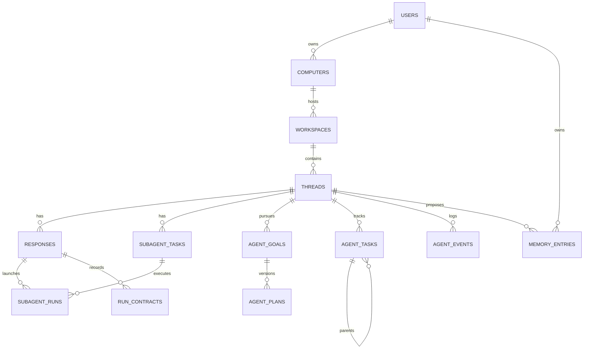

# 0004 — Unified data model and additive migration plan

Phase 1 target: make the existing entities explicit and add the missing state
without rewriting tables. The model builds on what is already in migrations
head (095) — it does not replace `conversation_*`, `subagent_*`, `turn_slices`,
`provenance_*` or the LangGraph store.

## Implementation status (Phase 1)

- **086–095 implemented** (additive, all with `downgrade()`): goals/plans, run
  contracts/subagent result columns, append-only agent events, memory-entry
  projection (tier/status/index-line + generated FTS), the main-agent task tree,
  the todo-identity index the snapshot reconciliation needs, the trigram index
  that gives CJK queries a retrieval path, the per-thread permission mode, and
  the reviewable memory-proposal queue. Verified on a real Postgres clone (upgrade 085→090, constraints, FTS
  query, downgrade 090→085) plus offline `--sql` generation and the single-head
  test; contract/migration binding is pinned by
  `tests/unit/migrations/test_refactor_migrations.py`.
- **Next**: dual-write wiring behind `REFACTOR_*` flags, using the reader views
  in `src/server/services/refactor/readers.py` (flag off hands the caller back to
  the legacy path) and the differential harness F1–F3.

## Existing entities (as-is)

| Entity | Storage today | Notes |
| --- | --- | --- |
| User | `users` | auth/ownership root |
| Computer | `computers` | sandbox ownership; workspaces bind to it |
| Workspace | workspace tables (`workspace_*`, `workspace_files`, folders/names) | folder on a computer |
| Thread | `conversation_threads` | conversation container |
| Turn / Response | `conversation_responses`, `conversation_queries`, `conversation_usages`, `conversation_feedback` | one model turn per response |
| Turn slice | `turn_slices` (064) | checkpoint-derived replay material |
| Subagent task | `subagent_tasks` (020) | logical task within a thread |
| Subagent run | `subagent_runs` (020) | one live run per task slot; predecessor chain; failure JSONB |
| Task run slice | `task_run_slices` (064) | replay material per subagent run |
| Transcript | `thread_transcripts`, `thread_transcript_files` (056) | rendered JSONL from checkpoints |
| Provenance | `provenance_records`, `provenance_result_bodies` | tool result lineage |
| Files/artifacts | `workspace_files`, `workspace_file_blobs` | workspace artifacts |
| Memory (content) | LangGraph `BaseStore` namespaces `(user, "memory")` and `(user, "workspaces", ws, "memory")`; memo namespace | content backend, no relational index |
| Skills / subagent defs | `user_skills`, `user_subagents`, `plugin_subagents` | definitions, not runs |
| Automations / wakeups | `automations` + `automation_executions`, `wakeups` | scheduled behavior |
| Event-ish tables | `hook_outbox`, `replay_facts`, `provenance_records` | overlapping, not one stream |
| Checkpoints | LangGraph checkpointer tables (library-managed) | reference by checkpoint id |
| LangGraph store | `store`, `store_migrations` | generic key/value store |

## Target relations



## Proposed additive changes

All new columns are nullable; all new tables are additive. Flags gate writes so
old readers keep working.

### 086 — `agent_goals`, `agent_plans`

```sql
CREATE TABLE IF NOT EXISTS agent_goals (
  goal_id uuid PRIMARY KEY DEFAULT gen_random_uuid(),
  user_id uuid NOT NULL,
  thread_id uuid NOT NULL REFERENCES conversation_threads(conversation_thread_id) ON DELETE CASCADE,
  workspace_id uuid,
  title text NOT NULL DEFAULT '',
  objective text NOT NULL DEFAULT '',
  stop_conditions jsonb NOT NULL DEFAULT '[]'::jsonb,
  status text NOT NULL DEFAULT 'active'
    CHECK (status IN ('active','paused','completed','cancelled','blocked')),
  budget jsonb NOT NULL DEFAULT '{}'::jsonb,
  verifier_config jsonb NOT NULL DEFAULT '{}'::jsonb,
  verifier_verdict jsonb,
  created_at timestamptz NOT NULL DEFAULT now(),
  updated_at timestamptz NOT NULL DEFAULT now(),
  completed_at timestamptz
);
CREATE INDEX IF NOT EXISTS ix_agent_goals_thread ON agent_goals(thread_id, status);
CREATE UNIQUE INDEX IF NOT EXISTS uq_agent_goals_active
  ON agent_goals(thread_id) WHERE status IN ('active','paused');

CREATE TABLE IF NOT EXISTS agent_plans (
  plan_id uuid PRIMARY KEY DEFAULT gen_random_uuid(),
  goal_id uuid NOT NULL REFERENCES agent_goals(goal_id) ON DELETE CASCADE,
  version int NOT NULL,
  steps jsonb NOT NULL DEFAULT '[]'::jsonb,
  status text NOT NULL DEFAULT 'draft'
    CHECK (status IN ('draft','awaiting_approval','approved','rejected','superseded')),
  feedback text,
  created_at timestamptz NOT NULL DEFAULT now(),
  decided_at timestamptz,
  UNIQUE (goal_id, version)
);
```

Downgrade drops both tables. No existing row migration; `agent_goals` starts
empty and only the new goal path writes to it.

### 087 — run contracts (`agent_run_contracts`, subagent contract columns)

```sql
CREATE TABLE IF NOT EXISTS agent_run_contracts (
  conversation_response_id uuid PRIMARY KEY
    REFERENCES conversation_responses(conversation_response_id) ON DELETE CASCADE,
  contract_version int NOT NULL DEFAULT 1,
  permission_mode text NOT NULL DEFAULT 'manual',
  model_id text,
  context_budget jsonb NOT NULL DEFAULT '{}'::jsonb,
  injected_memory jsonb NOT NULL DEFAULT '[]'::jsonb,  -- audited refs only, no content
  verifier_verdict jsonb,
  created_at timestamptz NOT NULL DEFAULT now()
);

ALTER TABLE subagent_runs
  ADD COLUMN IF NOT EXISTS contract_version int,
  ADD COLUMN IF NOT EXISTS context_budget jsonb,
  ADD COLUMN IF NOT EXISTS tool_allowlist text[],
  ADD COLUMN IF NOT EXISTS result jsonb,
  ADD COLUMN IF NOT EXISTS verification jsonb;
```

Downgrade drops the table and the added columns (data loss accepted only for
new-schema rows; documented in the migration docstring).

**Write path (implemented):** when `REFACTOR_SUBAGENT_CONTRACT_ENABLED=1`, the
server-side run coordinator projects a finished run after its winning finalize
CAS (`services/refactor/dual_write.record_subagent_result`): a completed run's
summary is its resolved result text (bounded 5 s; unavailable → nothing is
recorded rather than fabricating a result), failed/cancelled/interrupted runs
summarize the terminal status + error. One history read also derives the
structured body (`services/refactor/subagent_result.py`):
`artifact_ids` are files the run's successful Write/Edit calls produced,
`findings` are the summary's bullet lines outside an open-questions section, and
`open_questions` are the bullets under such a heading (`evidence` stays empty —
artifact paths are the checkable evidence; nothing else is a trustworthy
pointer). The contract row is written with
`database/refactor/runs.record_subagent_contract` (UPDATE-only; a missing ledger
row is reported and dropped), and a `subagent.result` event carries run id,
status, contract version, summary length and the structured counts only — never
the result body. The projection runs only when the CAS won, is best-effort, and
cannot fail the finalize. `proposed_memories` is now filled from the subagent's gated, write-free
`ProposeMemory` tool calls (validated against the contract vocabulary, bounded,
deduped); the read route lists them owner-scoped. Approval still has no path
until the store-writing slice (D5).

### 088 — `agent_events` (append-only)

```sql
CREATE TABLE IF NOT EXISTS agent_events (
  event_id bigserial PRIMARY KEY,
  user_id uuid NOT NULL,
  thread_id uuid,
  response_id uuid,
  task_run_id uuid,
  seq int NOT NULL,
  type text NOT NULL,
  payload jsonb NOT NULL DEFAULT '{}'::jsonb,  -- redacted at write time
  created_at timestamptz NOT NULL DEFAULT now()
);
CREATE INDEX IF NOT EXISTS ix_agent_events_thread ON agent_events(thread_id, event_id);
CREATE UNIQUE INDEX IF NOT EXISTS uq_agent_events_seq
  ON agent_events(response_id, seq) WHERE response_id IS NOT NULL;
```

Retention: prune by age/count behind a configurable job (default 90 days or
200k rows per deployment). Payload rules: no prompts in full, no secrets, no
provider keys; tool results only as ids/hashes, content via provenance tables.

### 089 — `memory_entries` (relational projection over the LangGraph store)

Content stays in the store. This table makes tiers/retrieval/audit possible.

```sql
CREATE TABLE IF NOT EXISTS memory_entries (
  entry_id uuid PRIMARY KEY DEFAULT gen_random_uuid(),
  user_id uuid NOT NULL,
  tier text NOT NULL CHECK (tier IN ('user','project','workspace','session','task')),
  namespace text[] NOT NULL,
  entry_key text NOT NULL,
  content_hash text NOT NULL,
  size int NOT NULL DEFAULT 0,
  status text NOT NULL DEFAULT 'active'
    CHECK (status IN ('active','superseded','proposed','rejected')),
  provenance jsonb NOT NULL DEFAULT '{}'::jsonb,
  source_thread_id uuid,
  source_response_id uuid,
  search tsvector,
  created_at timestamptz NOT NULL DEFAULT now(),
  updated_at timestamptz NOT NULL DEFAULT now(),
  UNIQUE (user_id, tier, entry_key, status)
);
CREATE INDEX IF NOT EXISTS ix_memory_entries_search ON memory_entries USING gin(search);
CREATE INDEX IF NOT EXISTS ix_memory_entries_user_tier ON memory_entries(user_id, tier, status);
```

Backfill: `scripts/refactor_memory_backfill.py` reads the user/workspace store
namespaces and upserts one projection row per **detail** entry (the index file
supplies each row's index line; idempotent on
`(user_id, tier, entry_key, status='active')`). Dry-run is the default, `--apply`
writes, parity (missing/extra/changed) is reported from the same store read, and
non-UUID dev user ids are skipped because the projection column is UUID. Runbook:
`docs/refactor/runbook-memory-backfill.md`.

Dual-write **implemented** (`services/refactor/memory_dual_write.py`): when
`REFACTOR_MEMORY_INDEX_ENABLED=1`, the run wraps its store in a delegating
facade, so memory-namespace `aput`/`adelete` mirror into the projection after the
store write succeeds — a detail write upserts with the pointer line (or the
description fallback), an index edit refreshes existing rows' `index_text` in one
unordered UPDATE, and a delete supersedes instead of erasing. Mapping rules are
shared with the backfill (`memory_projection.py`, so repair and live paths cannot
drift). A projection failure is logged and dropped: the store write still
succeeds and the backfill job repairs the row (store remains the source of
truth). Non-UUID dev user labels are skipped; non-memory namespaces (memos,
workflows) delegate untouched. Retrieval for index lines uses `simple` FTS for
latin and the pg_trgm path from 092 for CJK.

### 090 — `agent_tasks` (main-agent task tree)

`subagent_tasks` covers delegated tasks; main-agent todos are only emitted over
SSE today. Add a persisted tree so the UI and audit have one task model.

```sql
CREATE TABLE IF NOT EXISTS agent_tasks (
  task_node_id uuid PRIMARY KEY DEFAULT gen_random_uuid(),
  user_id uuid NOT NULL,
  thread_id uuid NOT NULL REFERENCES conversation_threads(conversation_thread_id) ON DELETE CASCADE,
  parent_node_id uuid REFERENCES agent_tasks(task_node_id) ON DELETE CASCADE,
  title text NOT NULL DEFAULT '',
  status text NOT NULL DEFAULT 'pending'
    CHECK (status IN ('pending','in_progress','completed','blocked','cancelled')),
  source text NOT NULL DEFAULT 'todo'
    CHECK (source IN ('todo','subagent')),
  subagent_task_ref text,
  created_at timestamptz NOT NULL DEFAULT now(),
  updated_at timestamptz NOT NULL DEFAULT now()
);
CREATE INDEX IF NOT EXISTS ix_agent_tasks_thread ON agent_tasks(thread_id, status);
```

Dual-write from TodoWrite middleware and subagent task creation behind
`REFACTOR_TASK_TREE_ENABLED`; old SSE path remains the read source until Phase 3.

### 091 — todo identity index

TodoWrite posts a whole snapshot; `agent_tasks` needs a stable identity to
reconcile against it. `(thread_id, title)` where `source='todo'` becomes a
partial unique index (titles are what the model rewrites in place), so the sync
upserts a status change instead of duplicating rows and a title re-added later
reuses its row. A second index `(thread_id, source, status)` serves the
cancellation sweep (rows still open but absent from the snapshot). Pre-index
duplicates, if any, are deduped keeping the earliest row.

```sql
CREATE UNIQUE INDEX uq_agent_tasks_todo_identity
  ON agent_tasks (thread_id, title) WHERE source = 'todo';
CREATE INDEX ix_agent_tasks_thread_source_status
  ON agent_tasks (thread_id, source, status);
```

Downgrade drops both indexes; rows are unaffected.

### 092 — CJK retrieval index

The live Postgres retrieval probe (0005) measured zero CJK recall: the `simple`
FTS lexer keeps contiguous Chinese text as one token, so neither a spaced two-term query nor an unspaced one (the literal fixtures live
in `scripts/memory_eval/retrieval_cases.json`) can match a longer index line.
`pg_trgm` supplies the missing path.

```sql
CREATE EXTENSION IF NOT EXISTS pg_trgm;
CREATE INDEX ix_memory_entries_trgm
  ON memory_entries USING gin ((entry_key || ' ' || index_text) gin_trgm_ops);
```

The expression is the text the service searches (key + index line). The service
branches by script: latin queries keep `websearch_to_tsquery('simple', …)` +
`ts_rank`, CJK queries use contains predicates per whitespace term (AND) or the
trigram similarity operator for a single unspaced run, ranked by
`similarity(...)`. `pg_trgm` is a trusted extension (1.6 on the target Postgres)
and needs no dictionary or segmenter — chosen over a tokenizer extension the
deployment image does not ship.

Downgrade drops the index but **keeps the extension** (database-wide, possibly
shared by other consumers); CJK recall falls back to zero, as measured.

**Exercised on a real Postgres (2026-10-25, M2 clone):** 085 → head applied all
seven migrations (092, `pg_trgm`, `ix_memory_entries_trgm` present); a seeded
memory row was retrievable by both the FTS and word-similarity predicates;
`downgrade 091` removed only the trigram index (extension kept, row kept, the
Jaccard path still returned the hit through a scan); `downgrade 085` removed the
new tables and the `subagent_runs` contract columns while the base schema stayed
intact; `upgrade head` recreated everything empty at 092. Clone dropped, copied
migrations removed, app database untouched (still 085, no extension).

### 093 — per-thread permission mode

D3 (0008) unified the approval policy over the checks that already exist. The one
mode change that is safe today is whether the user's **standing approvals**
(hand-offs, workspace creation) are honoured: `auto` keeps them (current
behaviour, and the absence of a row means this), `manual` shows every approval
card. `skip` is deliberately not a legal value — suppressing cards needs an
approval-capable gate that does not exist (0008 D3).

```sql
CREATE TABLE agent_thread_permissions (
  thread_id UUID PRIMARY KEY
    REFERENCES conversation_threads(conversation_thread_id) ON DELETE CASCADE,
  mode TEXT NOT NULL DEFAULT 'auto' CHECK (mode IN ('manual', 'auto')),
  updated_by TEXT,
  updated_at TIMESTAMPTZ NOT NULL DEFAULT NOW()
);
```

The turn build reads it once (flag `permissions`; missing row → `auto`) and
freezes it into that build's standing-approval middleware; the finalize contract
records the mode. Downgrade drops the table; missing rows mean the default.

**Exercised on a real Postgres (2026-10-25, M2 clone):** 085 → head applied 093;
a seeded thread accepted `manual` with `updated_by`, `skip` was rejected by the
CHECK; `downgrade 092` dropped only this table (memory projection intact, version
092); `upgrade head` recreated it empty at 093. Clone dropped, copies removed,
app database untouched (still 085, no `pg_trgm`, no permission table).

### 094 — reviewable memory-proposal queue

D5's proposal channel first stored proposals only inside the finished subagent
contract jsonb. Review needs identity and lifecycle, so extracted proposals now
also land in this queue (the contract stays the audit copy):

```sql
CREATE TABLE agent_memory_proposals (
  proposal_id UUID PRIMARY KEY DEFAULT gen_random_uuid(),
  user_id UUID NOT NULL,
  thread_id UUID NOT NULL,
  task_run_id UUID NOT NULL,
  proposal_type TEXT NOT NULL CHECK (proposal_type IN ('user','feedback','project','reference')),
  proposal_key TEXT NOT NULL,
  text TEXT NOT NULL,
  text_hash TEXT NOT NULL,
  status TEXT NOT NULL DEFAULT 'proposed'
    CHECK (status IN ('proposed','approved','rejected')),
  created_at TIMESTAMPTZ NOT NULL DEFAULT NOW(),
  decided_at TIMESTAMPTZ,
  UNIQUE (task_run_id, proposal_type, text_hash)
);
```

Extraction inserts with `ON CONFLICT DO NOTHING` (slug idempotency per run + type
+ hash; the hash keeps the unique index off the btree size limit); the read route
lists `proposed` rows owner-scoped; a decision CASes the row out of `proposed`.
**Approval path (implemented):** `POST /api/v1/memory/proposals/{id}/decision`
approves or rejects for the authenticated owner. Approval is fixed to manual
authority, writes one immutable detail revision at the memory root with its
pointer appended to `memory.md`, projects both writes through the normal
dual-write mapping, and then CASes the queue status. A PostgreSQL owner lock
serializes these pointer updates across workers. A retry reuses the same file
and does not duplicate the pointer. Reject is status-only. If the Store write
fails the queue remains `proposed`; a projection miss is repairable by backfill.

Migrations 134–136 retain proposal provenance and policy metadata. Migration 134
adds origin/evidence fields, 135 adds `change_kind`, replacement target, and
reason, and 136 adds an object-valued `metadata JSONB` column. The bounded policy
keys are `sensitivity`, `applies_when`, `exceptions`, and
`evidence_quote_ref`; legacy rows default to private sensitivity in readers.
Malformed sensitivity/conditions fail closed as secret, and secret proposals
are excluded from the queue and recall surfaces. Downgrading 136 removes only
that policy column and its object-shape constraint.

### 137 — durable memory consolidation proposals and multi-source lineage

Migration 137 adds optional `producer_kind`/`producer_id` identity for the
deterministic consolidation producer, a bounded `source_entry_ids` audit array,
and object-valued `producer_metadata`. Ordinary proposals keep their required
thread/task-run identity; consolidation rows require a producer identity and
2–16 source UUIDs. A unique producer key and the owner/day/policy claim table
make proposal creation idempotent across workers. The claim table keeps a
cursor, bounded attempt count, lease, retry time, and completion state.

Approved multi-source revisions retain the ordinary singular predecessor for
existing readers and add `memory_entry_lineage` edges to every same-owner,
same-tier, same-namespace source. The forget closure follows those explicit
edges, so forgetting any source reaches its consolidated descendant. The
approval remains manual; conflict choices preserve observed source bodies and
the first successful choice makes siblings stale. Upgrade is additive. Downgrade
refuses while producer proposals remain because their identity cannot fit the
prior task-run schema; an operator must explicitly remove those queue rows
before downgrade.

**Exercised on a real Postgres (2026-10-25, M2 clone):** 085 → head applied 094
with the table, its unique (task run, type, text hash) constraint and the
owner/status index; a seeded `feedback` proposal inserted, a duplicate inserted 0
rows (`ON CONFLICT DO NOTHING`), and an invalid proposal type was rejected by the
CHECK; `downgrade 093` dropped only this table (the permission table remained,
version 093); `upgrade head` recreated it empty. Clone dropped, copies removed,
app database untouched (still 085, no proposals table).

### Owner ids: UUID columns, non-UUID OSS owners

Every refactor table keys on a UUID owner, but OSS/local development
authenticates as the sentinel `local-dev-user`. The canary caught this as a hard
insert failure (`invalid input syntax for type uuid`). The rule is now:
`pg_sanitize.refactor_owner_uuid(value)` — real UUIDs pass through, any other
non-empty owner id maps deterministically (uuid5, fixed namespace) to one UUID —
and **every** refactor owner write and owner-scoped read uses it (events, goals,
tasks, memory projection/search, proposal queue, approval). The LangGraph store
keeps the raw owner label the app wrote; the projection maps it on write, and
proposal approval resolves the thread's raw owner for its store namespace so the
approved memory lands where the app reads memory. Other product tables are
untouched.

## Migration & compatibility rules

1. Additive only in Phases 1–2. No column drops/renames until Phase 4, and only
   after one release with dual-read.
2. Every migration has `downgrade()`; the up/down path is exercised on a copy of
   the staging DB and recorded in the PR.
3. Flags default **off** in Homelab; M2 app may enable them for acceptance.
4. Backfill jobs are idempotent and resumable; they never block a turn.
5. Reads fall back: goal/plan → thread state; event stream → existing
   provenance/SSE; memory projection → store index; task tree → SSE todos.
6. Schema drift check: add a unit/integration test asserting the new
   tables/columns exist at head and that `downgrade` restores the prior shape.
7. No new dependency is required; Postgres FTS (tsvector/GIN) is used instead of
   SQLite FTS5.

## Open questions

- Goal cardinality per thread (default: one active; history retained).
- Whether `agent_tasks` should own subagent nodes or keep `subagent_tasks` as the
  subagent source with a link column (default: link by `subagent_task_ref`, no
  duplication of run state).
- Event payload granularity for tool calls (ids + hashes vs truncated args).
- Memory tier for "project": extend workspace metadata or introduce an explicit
  project object (default: extend workspace, avoid a parallel entity).

### 095 — thread Swarm switch

`conversation_threads.swarm_enabled` is added by 095 after 094; it is unrelated to the refactor vocabularies and is safe on merged branches (idempotent add/drop).
